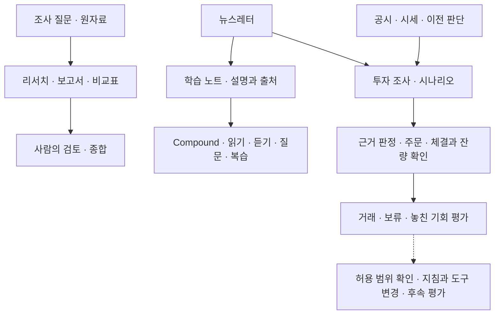

# AI 리서치·학습·투자 — 조사한 내용을 이해와 실행으로 연결하기

뉴스레터를 원인과 개념까지 설명한 학습 노트로 만들고, 시장·기업 조사를 매매 판단과 주문·체결 확인까지 연결했습니다. 과제별 리서치에서는 조사·문서화·출처 대조를 AI에 맡기고, 저는 결과를 검토해 결론과 발표의 흐름을 정합니다.

제가 설계한 것은 **각 업무가 내놓아야 할 결과와 완료 기준, 근거를 보관하고 바로잡는 방법, AI가 판단하거나 변경할 수 있는 범위**입니다. AI는 접근안·분석·구현을 맡습니다. 작업 지침과 실행 도구를 묶은 ‘스킬’을 만들어 실제 업무에 쓰고, 결과를 읽으며 기준을 수정해 왔습니다.

## 1. 세 업무는 각각 실행하고, 결과의 용도에 맞게 마칩니다

| 업무 | 입력 → 받는 결과 | 제가 판단하는 것 |
|---|---|---|
| 리서치·보고서 | 조사 질문·원자료 → 출처와 가정을 남긴 보고서·비교표·인터뷰 기록 | 질문에 답했는지, 어떤 전제가 결론을 좌우하는지, 여러 결과를 어떻게 종합할지 |
| 학습 | 직전 노트 이후의 뉴스레터 → 중요한 소식과 원인·개념·예외를 설명한 노트 | 왜 이 소식을 골랐는지, 처음 읽는 사람도 중간 과정을 이해할 수 있는지 |
| 투자 | 뉴스레터·공시·시세·이전 판단 → 시나리오, 매매·보류 이유, 주문·체결 기록, 주간 평가 | 투자 방식과 완료 조건, 변경할 규칙과 허용 권한. 개별 매매 판단은 AI에 위임 |

학습과 투자는 같은 뉴스레터를 각자 읽습니다. 학습 노트가 완성돼야 투자를 시작하는 구조는 아닙니다. 리서치는 과제별로 실행합니다. 출처 확인과 단계 검사 방법은 공유하지만 저장물과 검토 시점은 업무마다 다릅니다.

리서치의 **지식지도**는 과제 목적·현행 파일·핵심 판단·남은 질문을 안내하고, 호출할 때 갱신합니다. 학습은 날짜별 노트와 검증 기록을, 투자는 별도 DB에 사실·판단·주문·체결을 보관합니다. 감사에서 오류를 찾았다고 모든 스킬이 자동 수정되지는 않습니다. [입출력·저장물·권한의 전체 구조](docs/01_전체_흐름과_역할.md)

## 2. 결과를 실제로 쓰기 위해 정한 네 가지 기준

### 학습: 요약 뒤에 남을 질문까지 설명합니다

‘최대 실적’이라는 소식만 읽으면 왜 주가는 다르게 움직이는지 다시 찾아봐야 합니다. 저는 사건 아래에 원인, 개념의 작동 방식, 해당 뉴스와의 관계까지 담도록 했습니다. 직접 쓴 노트 **177개 항목**과 뉴스레터 **57통**을 AI가 대조하게 한 것도 제가 무엇을 골라 어디까지 알아봤는지 찾기 위해서였습니다.

처음에는 AI가 과거 항목 수와 주제 비중을 맞춰 내용을 채웠습니다. 저는 분량 대신 중요도·배울 점·새로 달라진 내용을 기준으로 삼도록 고쳤습니다. 설명 누락이 반복될 때는 문장만 고치지 않고 원인을 찾게 했고, AI가 사실·원인·개념·예외를 조사한 뒤 쓰는 순서로 바꿨습니다.

2026년 10월 16일 실제 노트는 좋은 실적에도 주가가 다르게 움직이는 이유를 시장 예상과 연결하고, 이전 기업 사례를 함께 설명합니다. 확인하지 못한 발표 후 주가 반응은 자료에 없다고 표시했습니다. 이 설명이 없으면 제가 다시 준비해야 할 질문이 결과물 안에 들어온 것입니다. [설명 기준과 실제 발췌](docs/03_학습노트_설계.md) · [노트 원문 일부](examples/실제_기록_발췌.md#study)

### 투자 실행: 주문 접수와 업무 완료를 구분합니다

저는 뉴스가 도착한 뒤 반응하는 데서 나아가, 사건이 산업과 기업에 미칠 영향을 조사하고 다음 사건과 대응 조건을 미리 준비하게 했습니다. AI가 매매를 판단하면 프로그램이 근거와 실행 조건을 검사하고 주문합니다. 개별 주문마다 사람이 승인하는 방식은 아닙니다.

초기에는 주문이 접수되자 체결 전에 실행을 끝냈습니다. 이후 실제 체결 수량과 잔량을 확인하고, 정정·취소 결과까지 남기도록 완료 기준을 정했습니다. **취소 요청만 보낸 상태에서는 같은 주문을 다시 보내지 않습니다.** 응답을 잃었을 때도 당일 주문 상태부터 확인합니다. 주문 전 필수 근거 확인과 주문 후 심층 감사는 시점을 나눴습니다. [조사부터 체결·평가까지](docs/04_투자_판단과_평가.md) · [감사로 주문이 만료됐던 사례](docs/05_검증과_개선.md#주문-전-확인과-주문-후-감사)

### 근거 관리: 사실을 고치면 무엇을 다시 판단해야 하는지 찾습니다

투자 조사에서 사실을 바로잡아도 분석 노트와 주문안에 이전 값이 남았습니다. 검사 질문과 사본 대조를 추가한 뒤에도 누락이 이어져, 같은 사실을 한곳에 저장하고 사용한 판단을 연결하도록 요구했습니다.

첫 DB안은 시장·산업·기업별로 무엇을 조사하고 어디에 쓸지 드러나지 않아 돌려보냈습니다. 필요한 조사 항목과 사용처를 먼저 정하고 뉴스레터·공시도 포함하며, 기존 자료를 빠짐없이 옮겼는지 대조하게 했습니다. AI가 구현한 구조는 사실 번호·값의 버전·사용처를 연결합니다. 값이 바뀌면 옛 판정을 그대로 인정하지 않고 재검증 대상으로 다룹니다. 사실의 교정과 매매 판단의 변경은 별도 절차입니다. [첫 설계 반려와 현재 데이터 연결](docs/07_근거데이터의_연결과_교정.md)

### 평가와 변경: 실행하지 않은 기회도 돌아봅니다

실제 거래만 평가하면 조사했지만 후보에서 빠진 종목은 볼 수 없습니다. 저는 사지 않은 이유와 놓친 기회까지 평가하도록 범위를 넓혔습니다. AI는 이미 조사한 종목이 시가총액 하한 때문에 가격이 오른 뒤에야 후보가 된 문제를 찾았습니다. 저는 매수 기준은 유지하면서 후보 편입 기준을 바꾸는 제안을 승인했습니다.

변경 뒤 디아이가 검토 대상에 들어온 것은 확인했지만, 당일에는 이미 급등해 매수하지 않았습니다. 변경 전 사례가 평가 자료에 섞였을 때는 효과 판정을 미뤘습니다. 후보 편입과 수익률 개선을 같은 성과로 계산하지 않았습니다.

주간 평가에서는 되돌릴 수 있는 일부 변경을 자동 적용하되, 안전장치·수치 기준·기존 규칙 삭제 등은 승인을 받도록 AI 권장안을 채택했습니다. 변경 후 자료로 효과를 확인하고, 표본이 부족하면 결론을 보류합니다. [사례·권한·후속 평가](docs/04_투자_판단과_평가.md#자동-변경과-승인) · [실제 기록](examples/실제_기록_발췌.md#investment)

## 3. Compound: 검증한 설명을 읽기·질문·연습으로 이어갑니다

긴 노트를 **핵심부터 펼쳐 읽고 핵심 또는 전체를 듣는 앱**입니다. 노트의 문장과 계층을 유지해 전달 과정에서 다시 요약하지 않습니다. 읽던 문장을 선택해 질문하면 날짜·항목·상위 설명도 함께 준비해 ChatGPT로 넘깁니다. 질문의 배경을 새로 복사하는 일을 줄이려는 선택입니다.

뉴스레터의 영어 표현은 예문과 복습 카드로, 회화는 상황·역할·미션을 준비해 ChatGPT로 연결합니다. 회화 뒤 실제 발언의 교정과 저장할 표현을 앱에 가져와 다음 연습에 씁니다. 텍스트만 받은 경우 발음 점수를 만들지 않도록 입력과 평가 범위도 맞췄습니다. [읽기·질문·회화·복습의 설계와 구현 발췌](docs/06_Compound_학습경험.md)

## 4. 맡은 역할과 확인한 결과

| 담당 | 역할 |
|---|---|
| 저 | 목적·설명 수준·완료 조건·변경 권한 설정, AI 제안의 채택·수정·반려, 결과 사용과 검토 |
| AI | 접근안 제안, 조사·개별 매매 판단·원인 분석, 코드 구현과 검증 |
| 프로그램 | 자료·판정·조건 대조, 사실과 사용처 연결, 주문 전송·체결 확인과 기록 |

리서치 방식은 BCG 업무에서 조사·출처 대조·1차 검수를 위임하고 결과를 종합한 경험에서 발전했습니다. 스킬과 가이드를 조직에 배포한 경험, 이후 개인 학습·투자 운영을 구분해 설명합니다. [리서치 결과물의 조건과 가이드북](docs/02_리서치_분석_보고서.md)

공개 투자 코드·운영 집계는 **2026년 10월 20일 기준**, 투자 사례는 **10월 17일까지의 모의 기록**입니다. 학습 노트 36일치·투자 분석 52회차분은 기록량이며 주문 건수·연속 운영일·수익 성과가 아닙니다. 학습할 내용과 검토·종합할 여유가 늘었다는 설명은 제 사용 경험입니다. 이해도·시간 절감률·수익률 개선을 측정한 결과로 제시하지 않습니다. [집계 정의와 공개 범위](docs/reference/운영_기록과_집계.md)

## 5. 관심 있는 판단부터 더 읽기

| 보고 싶은 내용 | 상세 문서·증거 |
|---|---|
| 독립된 업무를 어떻게 연결하고 운영하는가 | [전체 흐름과 역할](docs/01_전체_흐름과_역할.md) · [검증과 개선](docs/05_검증과_개선.md) |
| 사람이 검토할 수 있는 리서치 결과 | [리서치 설계](docs/02_리서치_분석_보고서.md) · [가이드북 발췌](examples/실제_기록_발췌.md#research) |
| 선별·설명·질문·복습의 기준 | [학습 노트](docs/03_학습노트_설계.md) · [Compound](docs/06_Compound_학습경험.md) |
| 투자 실행·미실행 평가·변경 권한 | [투자 판단과 평가](docs/04_투자_판단과_평가.md) · [실제 기록](examples/실제_기록_발췌.md#investment) |
| 사실의 버전과 판단의 사용처 | [근거 데이터 연결·교정](docs/07_근거데이터의_연결과_교정.md) · [DB 구조](ai-trading-bot/db_schema.sql) |
| 가상 입력으로 동작 확인 | [주문 규칙 검사 예제](examples/가상_사례_판단_과정.md) · [리서치 예제](examples/컨설팅_가상_사례.md) |

스킬 지침은 [.claude/skills/](.claude/skills/), 투자 실행 코드는 [ai-trading-bot/](ai-trading-bot/), 수집·노트 도구는 [gmail-newsletter-analyzer/](gmail-newsletter-analyzer/)에 있습니다. [전체 스킬 구성](docs/reference/스킬_구성.md)은 기술 참고용입니다. 실제 고객 자료·계좌 정보·구독 뉴스레터 원문 전체는 공개하지 않았습니다. 실제 발췌와 가상 재현을 구분해 표시했습니다.

Summary in English

I built three independently operated workflows: research produces source-backed reports and comparison tables; learning turns newsletters into notes that explain causes and concepts; investing connects market and company research to decisions, orders, fill reconciliation and weekly evaluation. Learning notes are not a prerequisite for trading, and the investment database is not a shared store for all three workflows.

I define the purpose, output standards, completion criteria and change authority. AI proposes approaches, performs research and individual trading decisions, and implements the tools. Representative decisions include deriving explanation standards from 177 items I wrote, requiring fill and remaining-order reconciliation, rejecting an initial database design that omitted research fields and their uses, and evaluating opportunities that were never traded. Some reversible weekly changes are pre-authorized; safety controls, numeric thresholds and rule deletion require approval.

Compound preserves the notes' structure for reading and listening, passes selected text with its parent context to ChatGPT, and connects English practice with corrections and review. Research methods grew out of my BCG work; learning and investing are personal projects.

Published investment code and counts are dated October 20, 2026; investment cases cover paper trading through October 17. The 36 note dates and 52 market/date analysis records describe accumulated records, not consecutive operation, order counts or improved returns. Learning gains are my experience, not measured comprehension or time savings. Client materials and account details are excluded.

