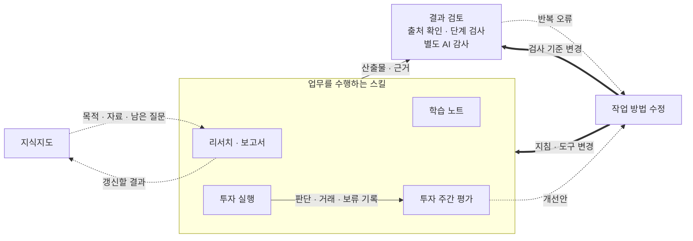

# AI를 팀원처럼 쓰기 위해 만든 업무 생태계

스킬들이 자료와 결과를 주고받으며 일하고, 검토에서 발견한 문제를 작업 지침과 도구의 개선에 반영합니다.

저는 AI를 활용해 혼자 할 수 있는 일의 범위를 넓히고 싶었습니다. 더 많은 자료를 읽고, 낯선 주제를 공부하고, 경험이 부족해 직접 하기 어려웠던 일도 해보고 싶었습니다. 리서치·학습·투자에 AI를 쓰기 시작한 이유입니다.

저는 AI를 **과제를 맡아 수행하는 독립적인 담당자**처럼 씁니다. 여러 인턴에게 각각 일을 맡기고 보고받는 방식에 가깝습니다. AI는 접근 방법을 제안하고 조사·작성·실행과 1차 검토까지 진행합니다. 저는 계획과 결과를 검토합니다.

과제의 목적, 기대하는 결과, AI가 판단해도 되는 범위는 제가 정합니다. 결과가 기대와 다르면 원인을 살피고 접근 방법을 다시 정합니다.

한 번 조사한 자료는 다음 과제에도 활용하고, 같은 오류를 반복하면 작업 방법을 고치고자 했습니다. 업무를 맡기는 절차에 자료 보관·결과 검토·지침 수정까지 포함한 이유입니다.

이 포트폴리오에는 그렇게 만든 시스템과 제가 내린 설계 결정을 담았습니다. 전체 구성, 실제 결과물, 설계 과정 순으로 소개합니다.

## 리서치에서 학습과 투자로

조사할 과제가 여러 개 들어오면, 자료를 찾고 정리하는 데 대부분의 시간을 썼습니다. 정작 결과를 이해하고 다른 조사와 연결해 생각할 시간은 부족했습니다. 이 때문에 AI에 조사와 정리를 맡기기 시작했습니다. 조사 결과를 보고받고, 무엇을 더 알아봐야 하는지와 그 결과가 무슨 뜻인지 생각하는 데 시간을 쓰고 싶었습니다.

이후 학습과 투자에도 AI를 쓰기 시작했습니다. 학습에서는 제가 일일이 질문을 준비하던 과정을 AI에 맡겼습니다. 투자에서는 제가 구상한 조사와 매매 방식을 AI와 프로그램이 수행하게 했습니다. 업무별 작업 지침과 도구를 묶은 **스킬**을 만들고, 결과 검토와 자료 관리, 지침 수정을 맡는 스킬도 추가했습니다. 리서치에서는 최종 해석을 제가 맡았고, 투자에서는 개별 매매 판단까지 AI에 맡기되 투자 방식과 변경 기준을 제가 정했습니다.

이 저장소에는 Claude Code에서 사용한 스킬과 실행 코드가 있습니다. 아래에서는 각 스킬이 어떻게 함께 작동하는지 설명합니다.

## 1. 전체 구성

| 업무 | AI에 맡긴 일과 받는 결과 | 제가 하려던 일 |
|---|---|---|
| 리서치·분석·보고서 작성 | 조사와 출처 대조를 거친 보고서·비교표·인터뷰 기록 | 여러 조사 결과를 이해하고 종합해 결론과 발표의 흐름을 정하기 |
| 뉴스레터 학습 | 중요한 소식을 고르고 원인·개념까지 설명한 노트 | 질문을 준비하는 부담을 줄이고 더 많은 내용을 읽고 이해하기 |
| 투자 | 산업·기업 조사, 매매 판단과 실행, 거래·보류 결과의 평가 | 제가 생각한 투자 방식을 실행하고 수익률 개선 방법을 찾기 |

업무별 스킬은 자료 탐색·출처 확인·결과 검토 도구를 함께 사용합니다. 조사 결과를 다음 과제에 넘기고, 반복 오류는 작업 지침과 도구에 반영하도록 연결했습니다.



실선은 작업과 검토에 넘기는 자료, 점선은 참조 기록과 개선안, 굵은 선은 지침과 도구의 변경입니다. 세 업무는 각각 실행합니다. 리서치에서는 지식지도로 지난 자료를 찾고, 투자에서는 데이터베이스에 저장한 사실과 판단을 다음 실행에서 읽습니다.

| 함께 쓰는 역할 | 하는 일 | 담당 |
|---|---|---|
| 출처 확인 | 주장과 원문을 대조하고 고칠 내용에 근거를 붙임 | 학습·투자의 `fact-check`, 리서치의 `research-verified`·`research-source-check` |
| 단계 검사 | 다음 작업에 필요한 자료와 조건이 갖춰졌는지 확인 | 공통 검사 프로그램 `_stepgate`와 업무별 검사 항목 |
| 별도 검토 | 작성한 AI와 다른 AI가 결과를 읽고 누락·오류를 지적 | `gate-audit` |
| 맥락 보존 | 과제의 목적·현재 자료·판단·남은 질문을 정리 | 업무용 `knowledge-map`, 개인 프로젝트용 `life-map` |
| 작업 방법 수정 | 문제의 원인을 찾아 지침·도구를 고치고 관련 연결도 확인 | `skill-maintainer` |

저는 목표와 기준, 무엇까지 AI가 바꿔도 되는지를 정합니다. AI는 조사·해석·개선안과 구현을 맡고, 프로그램은 기록과 실행 조건을 확인합니다. 지도는 갱신을 요청했을 때 고치며, 감사에서 오류를 찾았다고 곧바로 스킬을 수정하지는 않습니다. [업무별 연결](docs/01_전체_흐름과_역할.md)

작업 방법을 바꿀 때는 `skill-maintainer`가 기존 지침의 목적을 읽고, 수정 전후와 이를 참조하는 다른 스킬까지 확인합니다. 투자 주간 평가에는 정해 둔 범위의 자동 수정을 허용했지만, 안전장치·수치 기준 변경과 기존 규칙 삭제 등은 제 승인을 받게 했습니다. [변경 권한과 수정 절차](docs/05_검증과_개선.md#수정할-때-확인하는-것)

## 2. 세 업무에서 달라진 점

### 리서치: 여러 조사 결과를 검토하고 종합합니다

과거 업무에서는 AI에 조사와 문서 작성을 맡기면서 더 많은 과제를 처리할 수 있었습니다. 저는 조사 결과를 읽고 서로 비교하는 데 시간을 썼습니다. 내용을 더 깊이 이해하면서 최종 발표의 스토리라인 작성에도 기여할 수 있었습니다.

다른 사람도 이 방식으로 일할 수 있게 스킬과 업무 가이드북을 정리해 소속 조직에 배포했습니다. 제가 쓴 **실제 가이드북**에는 역할을 다음과 같이 적었습니다.

> 노동집약적인 1차 작업과 1차 검수는 AI가 맡고, 목표·기준·최종 판단은 사람이 맡음

가이드북에는 과제를 맡기는 방법, 결과를 검토하는 기준, 추가 조사를 요청하는 방법을 정리했습니다. [가이드북 발췌](examples/실제_기록_발췌.md#research) · [그에 맞춰 바꾼 업무 방식](docs/02_리서치_분석_보고서.md)

### 학습: 읽고 이해하는 데 집중합니다

예전에는 뉴스레터 한두 개를 읽기도 버거웠습니다. 모르는 내용을 찾아 질문을 준비하는 데 시간이 많이 들었습니다. 지금은 AI가 여러 뉴스레터에서 내용을 고르고 필요한 설명을 붙여 노트로 정리합니다. 저는 그 노트를 읽으며 공부합니다. 매번 질문을 준비할 필요가 줄어 이전보다 훨씬 많은 내용을 공부하게 됐습니다.

아래는 **10월 16일 실제 학습 노트**의 일부입니다. 기업의 최대 실적 소식 아래에 이런 설명이 이어집니다.

> 주가에는 미래 기대가 먼저 반영돼 있어 이미 더 좋은 결과를 예상한 투자자에게는 새 호재가 아님 → 숫자 자체보다 시장 예상과의 차이와 다음 분기 전망 확인 필요(UPPITY).

같은 항목의 다음 문장입니다.

> 같은 주 ASML도 사상 최대 실적에 연간 전망까지 올렸지만 주가 하락(UPPITY · 10/15 노트). TSMC 실적 뒤 주가 반응은 재료에 미기재

“좋은 실적이면 주가도 오를까?”라는 질문에 노트가 답합니다. 앞서 읽은 기업 사례를 함께 설명하고, 확인하지 못한 주가 반응은 따로 표시했습니다. [원문과 읽는 안내](examples/실제_기록_발췌.md#study)

10월 20일 기준으로 **36일치 노트**가 쌓였습니다. 같은 날짜의 수정본·감사본·복습본은 제외한 수입니다. [직접 쓴 노트에서 작성 기준을 찾은 과정](docs/03_학습노트_설계.md)

노트를 읽는 과정은 **Compound**라는 학습 앱으로 연결했습니다. 긴 노트는 핵심부터 보고 필요한 설명을 펼치며, 이동 중에는 음성으로 듣습니다. 읽던 부분을 선택해 질문하면 제목과 상위 설명도 함께 전달합니다. AI가 선택한 낱말의 뜻을 해당 사건과 설명에 맞춰 답하도록 구성했습니다.

뉴스레터에서 고른 영어 표현과 회화에서 교정받은 문장도 같은 앱에서 복습합니다. 읽고 이해한 내용을 다시 쓰고 말해 보는 흐름으로 이어집니다. [읽기·질문·복습을 연결한 설계](docs/06_Compound_학습경험.md)

### 투자: 제가 생각한 투자 방식을 실행합니다

투자를 시작할 당시에는 시장과 기업에 관한 지식이 부족했습니다. 대신 사건이 산업과 기업에 미칠 영향을 조사하고, 앞으로 확인할 일과 대응 조건을 미리 정하면 어떨까 생각했습니다. AI가 그 방식으로 조사하고 판단하며, 프로그램이 주문과 체결을 처리하게 했습니다. 제가 받는 것은 매매 내역과 그 이유, 다음에 확인할 조건, 한 주의 판단을 되짚은 보고서입니다. 아래 사례는 10월 17일까지의 모의투자 기록입니다.

아래는 **10월 7일 케이씨텍 검토 기록**과 10월 10일 평가의 요약입니다.

| 당시 판단 | 남긴 근거 |
|---|---|
| 매수하지 않음 | 이미 급등한 뒤였고, 검토한 공개 목표가까지 남은 상승 여력이 약 4% |
| 적용한 조건 | 매수 시 남은 상승 여력의 하한은 10%. 이를 맞추려고 목표 가격을 올리지 않음 |

저는 매수할 때 필요한 최소 여력과 매도 시점을 정하는 기준을 구분했습니다. 10%는 매수를 검토할 하한으로 쓰고, 상승이 이어지는 종목의 매도 시점은 AI가 따로 판단하게 했습니다.

<details>
<summary>정한 매수 기준을 코드에 적용한 예시</summary>

아래는 가상 주문 제안을 공개 코드로 검사한 결과입니다. 주문 전송과 체결은 실행하지 않았습니다.

```text
승인 1건 / 거부 2건 → signals/approved_261012_kr.json
  [제안] BUY  900001 한빛전선(가상) x12 @ 24,850.00
  [거부] BUY  900002: 목표 여유 없음 — 기준 수준 resistance_1 12,300이 현재가 12,050 대비 +2.1% (< 바닥 10%) · 바닥을 넘기려고 수준을 바꾸지 않는다
  [거부] BUY  900004: 유니버스 밖 종목 (watchlist 미등재·미보유). watchlist_candidates로 제안할 것
```

동양구리(900002)는 남은 상승 여력이 2.1%로 하한 10%에 못 미쳐 거부됐습니다. 코스모AI(900004)는 매매 대상 목록 밖이어서 거부됐습니다. [입력과 전체 과정](examples/가상_사례_판단_과정.md)

</details>

주간 평가에서는 여기서 한 가지를 더 물었습니다. **그 전에 조사한 종목인데, 왜 오르기 전에는 매수 검토를 하지 못했을까?** 그 질문이 후보 선정 방식을 바꾸는 계기가 됐습니다. 다음 절에서 그 과정을 설명합니다. [실제 기록의 경과](examples/실제_기록_발췌.md#investment)

## 3. 목표를 이루기 위해 무엇을 바꿨는가

<a id="놓친-투자-기회의-원인을-찾았습니다"></a>
### 투자 규칙을 바꿀 때는 원인부터 살폈습니다

투자의 목표는 수익률 극대화입니다. 기업을 조사해 놓고도 매수 후보에서 빠뜨리거나, 가격이 오른 뒤에야 검토한다면 조사 결과를 매매에 활용하기 어렵습니다. 10월 2일 저는 실제 거래와 함께 놓친 상승과 사지 않은 이유도 평가해 달라고 요청했습니다. 수익을 놓쳤을 때, 당시 판단을 바꿔야 하는지 그 판단에 이르는 과정을 고쳐야 하는지 구분하려고 했습니다.

10월 10일 평가에서는 케이씨텍을 처음 조사한 시점부터 다시 살폈습니다. 9월 21일 이미 반도체 산업의 후속 수혜 후보로 조사했지만, 매매 대상에 들어온 것은 10월 6일이었습니다. 그전까지는 시가총액 기준을 충족하지 못했습니다. 앞서 본 10월 7일에는 이미 급등해 남은 상승 여력이 작았습니다. 그날 매수하지 않은 판단과, 오르기 전에 검토할 수 없었던 원인은 달랐습니다.

AI는 시가총액 하한을 낮추되 거래대금 등 다른 조건은 유지하자고 제안했습니다. 저는 매수 기준은 지키면서 조사한 종목을 더 일찍 검토할 수 있다는 점에서 이 안을 승인했습니다. 10월 11일 적용한 뒤 다음 날 같은 조건에 막혀 있던 디아이가 검토 대상에 들어왔습니다. 다만 편입 당일에도 이미 급등한 상태여서 매수하지 않았습니다.

디아이가 후보에 포함된 것은 확인했지만, 수익률이 개선됐는지는 아직 알 수 없습니다. 10월 17일 평가에서는 바뀐 편입 기준을 유지하고, 효과는 10월 24일에 다시 확인하기로 했습니다. 평가 자료에 기준 변경 전의 사례가 섞여 있었기 때문입니다.

매수를 중단할 조건도 검토했습니다. 10월 17일 AI는 여러 보유 종목에 영향을 주는 공통 요인이 약해지면 매수를 일괄 중단하자고 제안했습니다. 저는 하락 원인을 먼저 살펴 저점 매수·보유·매도 중 무엇을 할지 결정해야 한다고 봤습니다. 투자 근거가 무너진 경우와 일시적인 하락에는 다른 대응이 필요하기 때문입니다.

현재는 원인과 대응 판단이 빠진 관련 매수 제안을 거부합니다. 수익률 효과는 평가 중입니다. [투자 판단·실행·평가의 설계](docs/04_투자_판단과_평가.md)

### 리서치는 출처 대조와 1차 검수까지 맡겼습니다

리서치에서는 여러 조사 결과를 이해하고 종합해 발표의 흐름을 만드는 데 시간을 쓰고 싶었습니다. 그런데 AI가 자료를 빨리 찾아 주더라도 제가 원문을 전부 다시 확인하고 보고서로 정리해야 한다면, 과제가 늘수록 제 일이 그대로 늘어납니다. 제가 쓴 가이드북에서도 시간·정확성·깊이·범위의 요구가 충돌한다는 점을 짚었습니다.

그래서 조사와 문서 작성, 출처 대조와 1차 검수까지 하나의 과제로 맡겼습니다. 제가 먼저 목적과 기대 결과물을 설명하면 AI가 조사 방법과 문서 구성을 제안했습니다. 저는 계획과 결과를 보며 조사 질문에 답했는지, 분류 기준과 가정이 적절한지, 무엇을 더 알아봐야 하는지를 검토했습니다.

결론과 함께 AI의 판단 근거도 확인하고자 했습니다. 보고서에는 주장·근거·분석을 나눠 적고, 비교표에는 계산의 기초 값과 가정을 남기게 했습니다. 저는 어떤 전제가 결론을 좌우하는지 보고 추가 조사를 요청할 수 있었습니다.

같은 과제를 다시 맡길 때는 앞서 내린 판단부터 이어받게 했습니다. 파일명만으로는 어떤 질문에 답하려던 자료인지 알기 어려워, 과제별 목적·현재 파일·핵심 판단·남은 질문을 지식지도에 정리했습니다. 세부 근거는 원본에 두고, 지도에는 과제의 진행 상황과 이어 할 일을 간추렸습니다. [업무를 나눈 기준과 현재 스킬 구성](docs/02_리서치_분석_보고서.md)

<a id="학습-노트에는-제가-궁금해할-내용도-설명하게-했습니다"></a>
### 추가 질문 없이 이해할 수 있도록 설명을 보강했습니다

뉴스를 많이 받아도 이해되지 않는 부분을 제가 매번 찾아 물어야 한다면, 읽을 수 있는 양은 크게 늘지 않습니다. 노트에 사건의 원인과 용어의 뜻, 그 개념이 해당 사건에서 중요한 이유까지 담고자 했습니다. 앞서 본 실적과 주가의 관계처럼, 읽다가 생기는 질문도 노트 안에서 해소하도록 작성 기준을 정했습니다.

원하는 설명 수준을 정하려고 AI에 제가 직접 쓴 노트 177개 항목과 뉴스레터 57통을 비교해 달라고 했습니다. 어떤 소식을 골랐고 무엇을 더 알아봤는지 찾으려는 작업이었습니다. 그런데 AI는 과거 항목 수와 주제 비중에 맞춰 내용을 채웠습니다. 저는 선별 건수 자체에 의미를 두지 말라고 했습니다. 필요한 설명을 갖췄는지와 왜 그 내용을 골랐는지를 기준으로 삼았습니다.

설명 누락을 검사해도 비슷한 문제가 다음 노트에서 반복됐습니다. 저는 그 원인을 찾아 작성 방법부터 고치자고 했습니다. AI는 사실·원인·개념·예외를 먼저 조사하고, 그 내용을 바탕으로 초안을 쓰는 순서로 바꿨습니다.

지금은 작성한 AI가 원자료를 모르는 독자의 입장에서 다시 읽고, 다른 AI가 추가한 사실의 출처를 대조합니다. 저는 완성된 노트를 읽으며 설명이 충분한지 확인합니다. 공부량이 늘었다는 것은 제 사용 경험이며, 검사 통과나 노트 수로 이해도를 측정한 것은 아닙니다. [선별과 설명 방식을 바꾼 과정](docs/03_학습노트_설계.md)

### 근거 확인과 후속 감사를 나눠 주문 지연에 대응했습니다

주문 근거를 확인하는 동안 가격과 상황이 바뀌면 판단의 유효성도 달라집니다. 10월 13일에는 감사가 반복되는 동안 약 5시간이 지나, 제안된 주문이 모두 유효시간 초과로 거부됐습니다. 오류를 막으려던 검토 절차 때문에 주문 시점을 놓쳤습니다.

저는 주문 전까지 근거 확인을 끝내고, 그 판정을 다시 살피는 감사는 주문 뒤에도 이어가기로 정했습니다. 후속 감사에서 매수 근거가 성립하지 않는 것으로 바뀌면 해당 매수분을 팔기로 했습니다. 그사이의 가격 변동과 거래 비용은 남습니다. 10월 15일에도 감사 기준을 느슨하게 하지 말고 작성 단계에서 충분히 조사하고 설명하라고 요구했습니다. [검토 대상과 시점을 나눈 과정](docs/05_검증과_개선.md#주문-전-확인과-주문-후-감사)

<a id="같은-사실을-여러-문서에-복사하면서-수정이-누락됐습니다"></a>
### 근거가 사실인지와 판단에 맞는지는 따로 확인합니다

조사한 사실은 한 번 저장해 여러 판단에서 함께 씁니다. 원문이 바뀌거나 사실을 교정하면, 그 사실을 쓴 판단도 다시 확인하도록 연결했습니다. 복사한 문장을 각각 고치던 문제를 줄이기 위해 만든 구조입니다.

저장된 사실이 맞더라도 지금의 판단에 그대로 쓸 수 있는 것은 아닙니다. 예를 들어 12개월 뒤의 목표가를 며칠 안에 실현할 수 있는 가격처럼 사용하면 판단이 달라집니다. 저는 목표가가 어느 기간을 전제로 하는지, 투자 판단은 얼마 동안의 변화를 예상하는지 함께 고려하도록 요구했습니다. 두 기간을 일률적인 비율로 환산하는 대신, 해당 근거를 그 판단에 사용할 이유를 설명하게 했습니다.

현재는 근거를 검증할 때 수치와 함께 기간·주체·조건을 나눠 확인합니다. 원문의 ‘예상’이나 ‘잠정’ 같은 단서도 검증 대상에 포함합니다. 원문에 있는 수치인지와 그 수치가 해당 판단을 뒷받침하는지를 구분해 살피는 방식입니다. [근거의 조건과 사용 목적을 함께 확인하는 방법](docs/05_검증과_개선.md#근거의-조건과-사용-목적을-함께-확인합니다)

## 4. 현재 운영과 더 볼 자료

| 주기 | 시작하는 작업 |
|---|---|
| 평일 11:00 | 학습 노트 작성 |
| 국내 시장 평일 09:30 | 국내 투자 실행 |
| 미국 시장 개장 5분 뒤 | 미국 투자 실행 |
| 토요일 아침 | 투자 주간 평가 |

예약 작업은 사람이 답변하지 않는 상황을 전제로 실행합니다. 위 시각은 시작 기준이며, 주문은 조사와 검사를 마친 뒤 전송합니다. 리서치는 과거 업무에서 과제에 맞는 스킬을 골라 사용했습니다.

스킬·실행 코드에 더해 Compound의 학습 경험과 근거 검증 방식을 함께 설명합니다. 투자 판단·평가 사례는 **10월 17일까지의 모의투자 기록**에서 골랐습니다. 실제 가이드북과 학습·투자 기록은 선택한 부분만 공개했습니다. 고객 자료와 계좌 정보·성과 수치는 포함하지 않았습니다. 생각할 시간과 학습량에 관한 설명은 제 사용 경험이며, 투자 수익성 개선은 아직 평가 중입니다. [기록의 종류와 집계 기준](docs/reference/운영_기록과_집계.md)

| 더 살펴볼 내용 | 자료 |
|---|---|
| 실제로 작성하고 읽은 자료 | [업무 가이드·학습 노트·투자 평가 발췌](examples/실제_기록_발췌.md) |
| 업무별 문제의식과 설계 | [리서치](docs/02_리서치_분석_보고서.md) · [학습](docs/03_학습노트_설계.md) · [Compound](docs/06_Compound_학습경험.md) · [투자](docs/04_투자_판단과_평가.md) |
| 스킬이 자료를 넘기고 검토·수정하는 방법 | [전체 설계](docs/01_전체_흐름과_역할.md) · [검증과 개선](docs/05_검증과_개선.md) |
| 구현과 재현 | [스킬 구성](docs/reference/스킬_구성.md) · [투자 코드](ai-trading-bot/README.md) · [가상 입력으로 실행하는 검사 예제](examples/가상_사례_판단_과정.md) · [뉴스레터 도구](gmail-newsletter-analyzer/README.md) |

### 폴더별 역할

| 폴더 | 담긴 내용 |
|---|---|
| [.claude/skills](.claude/skills/) | AI가 따르는 업무별 지침과 검토·기록·개선에 쓰는 공통 도구 |
| [ai-trading-bot](ai-trading-bot/) | 시장 자료 수집, 주문 검사·전송·체결 확인, 투자 기록과 평가를 처리하는 코드 |
| [docs](docs/) | 전체 구조, 업무별 설계와 시행착오, 운영·검증 참고 자료 |
| [examples](examples/) | 실제 기록 발췌, 설명용 가상 사례, 코드 재현 예제 |
| [gmail-newsletter-analyzer](gmail-newsletter-analyzer/) | 뉴스레터 수집과 학습 노트 검사·파일 관리 도구 |
| [tools](tools/) | 스킬 구성과 검사 항목을 집계해 참고 문서를 만드는 도구 |
