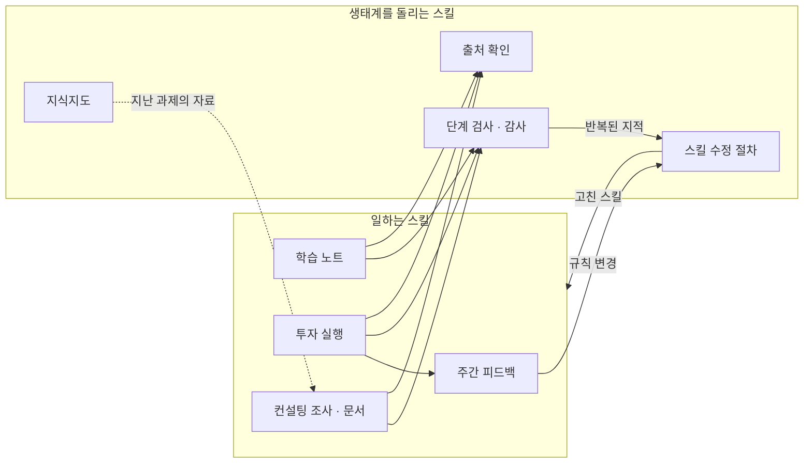

# 서로 부르고, 검사하고, 고치는 스킬 17개 — 공부·투자·조사를 돌리는 AI 작업 생태계

AI에 일을 맡기면 세 가지가 따라옵니다. 했다는 말을 그대로 믿을 수 없고, 지난 일의 결론이 다음 일로 넘어가지 않고, 같은 실수가 되풀이됩니다. 저는 이 셋을 막는 장치를 일하는 스킬들 사이에 끼워 넣었습니다. 그래서 제 스킬은 하나씩 따로 돌지 않습니다. 일하는 스킬이 검사 스킬을 부르고, 검사가 남긴 지적을 수정 스킬이 받아 일하는 스킬을 고칩니다.

여기서 스킬은 제가 Claude Code에 파일로 적어 둔 작업 절차와 판단 기준입니다. 2026년 6월 컨설팅 리서치에서 처음 만들었고, 8월 말에 금융 뉴스레터 학습 노트, 9월에 모의투자(증권사 모의계좌로 하는 매매)로 넓혔습니다. 지금은 평일 아침 9시 30분에 국내 매매가, 11시에 학습 노트가, 밤 10시 35분에 미국 매매가, 토요일 아침에 한 주의 매매 평가가 예약 작업으로 돌아갑니다. 그 시각에 저는 자리에 없습니다.

## 1. 생태계의 구성

### 일하는 스킬

| 스킬 | 받는 것 | 내는 것 |
|---|---|---|
| 학습 노트 작성 (world-study) | 직전 노트 이후에 온 뉴스레터 | 사실 아래에 원인과 개념을 적은 노트 |
| 투자 실행 (trade-run) | 뉴스레터, 공시, 시세와 잔고, 지난 시나리오 | 분석 노트, 조건이 붙은 주문 제안, 주문과 체결 기록 |
| 주간 피드백 (trade-feedback) | 한 주의 매매 기록과 시세 | 놓친 상승과 사지 않은 판단의 평가, 규칙 변경 제안 |
| 컨설팅 조사 (research-verified) | 조사 질문 | 주장마다 출처가 붙은 조사 결과 |
| 보고서와 표 (research-docx, research-organizer) | 검증을 통과한 조사 내용 | Word 보고서, Excel 비교표 |
| 산출물 감리 (research-source-check) | 완성된 보고서 | 링크와 인용을 원문과 대조한 교정 지시서 |
| 인터뷰 기록, 전문가 답변, 공시 분석 (consulting-interview-note, expert-vq-compiler, dart-analysis) | 녹취, 응답 메일, 재무제표 | 인터뷰 기록, 응답 정리표, 재무 분석 |
| 일상 조사 (life-research) | 생활과 실무 질문 | 출처를 단 조사 답 |

### 생태계를 돌리는 스킬

일하는 스킬 사이에 끼어 있는 스킬입니다. 앞에서 말한 세 가지 문제를 하나씩 맡습니다.

| 막으려는 것 | 스킬 | 하는 일 |
|---|---|---|
| 했다는 말을 믿는 것 | 출처 확인 (fact-check) | 노트와 주문 제안에 덧붙인 주장을 원문과 대조해 일치, 불일치, 시효 지남, 확인 불가로 판정합니다 |
| | 단계 검사 엔진 (_stepgate) | 작업 단계가 끝날 때마다 AI가 검사 질문에 답하고, 프로그램이 산출 파일을 열어 대조합니다. 통과 기록이 없으면 다음 단계로 못 갑니다 |
| | 감사 (gate-audit) | 통과한 산출물을 다른 AI가 다시 읽고, 지적을 유형별로 기록합니다 |
| 지난 일이 다음 일로 넘어가지 않는 것 | 지식지도 (knowledge-map, life-map) | 과제 폴더의 위치, 현재 산출물, 남은 질문을 지도에 남깁니다. 새 과제는 여기서 시작합니다 |
| 같은 실수를 되풀이하는 것 | 스킬 수정 절차 (skill-maintainer) | 스킬 파일을 고칠 때 고치기 전후를 대조해 사라진 줄이 없는지 보고, 관련 검사와 테스트를 다시 돌립니다. 감사에서 반복된 지적을 검사 문항으로 올립니다 |

### 어떻게 맞물리는가



뉴스레터 한 통을 따라가면 맞물리는 모습이 보입니다. 평일 11시, 학습 노트 스킬이 그 뉴스레터를 읽고 다룰 항목을 골라 사실 아래에 원인과 개념을 적습니다. 원문에 없는 설명을 덧붙이면 표시를 달고, 출처 확인 스킬이 그 문장을 원문과 대조합니다. 노트를 내기 전에 단계 검사를 통과해야 하고, 낸 뒤에는 감사가 다시 읽습니다.

같은 뉴스레터를 투자 실행 스킬도 읽습니다. 먼저 지난 실행이 남긴 시나리오를 확인하고, 그다음 뉴스를 읽어 어떤 사건이 어느 산업과 기업에 영향을 주는지 분석합니다. 결과는 조건이 붙은 매수, 매도, 보류 판단이고, 주문 근거는 출처 확인 스킬이 주문 전에 판정합니다. 프로그램이 그 제안을 주문 규칙으로 검사해 승인과 거부를 정하고, 승인된 주문만 보내 체결을 확인합니다. 여섯 단계마다 단계 검사가 있습니다.

토요일에는 주간 피드백 스킬이 그 주에 놓친 상승, 매도 시점, 손실 거래, 사지 않은 판단을 당시 기록과 대조해 규칙 변경을 제안합니다. 되돌릴 수 있는 변경은 스킬 수정 절차를 거쳐 다음 월요일 실행에 들어가고, 안전장치나 수치 기준을 바꾸는 변경은 제 승인을 기다립니다. 감사에서 두 번 이상 반복된 지적도 같은 절차로 검사 문항이 됩니다. 2026년 9월 28일부터 10월 20일까지 지적 123건 중 74건이 그렇게 검사 문항이 됐습니다.

역할은 셋입니다. 저는 업무의 목표와 결과물의 기준을 정하고, 결과를 읽어 문제를 지적하고, 승인 대상으로 정한 변경을 결정합니다. AI 세션은 자료를 읽고 고르고 해석해 판단안을 쓰고, 검사 질문에 근거 파일을 인용해 답합니다. 프로그램은 자료를 모으고 상태를 저장하고 파일과 수치를 검사하고 주문을 보냅니다. 주문을 승인할지 거부할지는 AI가 아니라 프로그램이 규칙으로 정합니다.

스킬이 스킬을 부르는 관계 전체와 일주일의 시간표는 [큰 그림 — 스킬을 함께 쓰는 방식](docs/01_큰_그림_스킬을_함께_쓰는_방식.md)에 있습니다.

## 2. 이 생태계가 제게 주는 것

### 투자 — 원래 못 하던 일을 하게 됐습니다

저는 시장 상황이나 뉴스를 잘 모르고 시사 상식도 많지 않아서 무엇을 사야 할지 몰랐습니다. 공부한다고 투자를 잘하게 된다는 보장도 없었습니다. 대신 "이렇게 투자하면 좋지 않을까" 하고 생각하던 방식을, 제가 직접 하는 게 아니라 시스템이 그렇게 하게 만들었습니다. 뉴스를 보고 사는 게 아니라 앞일을 예상해 두고, 그 일이 생기면 정해 둔 조건대로 대응하는 방식입니다.

실행 중에 제가 결정할 자리는 없습니다. 주문을 낼지, 얼마나 낼지, 손절선에 닿으면 팔지는 규칙과 기록이 정합니다. 사지 않은 판단과 그 이유까지 남기 때문에, 매주 제 가설이 맞았는지 틀렸는지 점검할 수 있습니다.

가상 사례에서 주문 제안 세 건을 실제 코드로 검사한 결과입니다.

```text
승인 1건 / 거부 2건 → signals/approved_261012_kr.json
  [제안] BUY  900001 한빛전선(가상) x12 @ 24,850.00
  [거부] BUY  900002: 목표 여유 없음 — 기준 수준 resistance_1 12,300이 현재가 12,050 대비 +2.1% (< 바닥 10%) · 바닥을 넘기려고 수준을 바꾸지 않는다
  [거부] BUY  900004: 유니버스 밖 종목 (watchlist 미등재·미보유). watchlist_candidates로 제안할 것
```

두 번째 제안은 목표 가격이 현재가보다 2.1%밖에 높지 않아서 거부됐습니다. 상승 여력 10%는 제가 정한 하한입니다. 세 번째는 뉴스레터의 권유 문장을 근거로 올라온 종목인데 매매 대상 목록에 없어서 거부됐습니다. 거부 사유는 이렇게 기록으로 남습니다.

2026년 9월 9일부터 10월 20일까지 실행 52회(국내 25회, 미국 27회), 거래 기록 45일, 주간 피드백 3회가 쌓였습니다. 뉴스에서 세운 시나리오가 알맞은 종목 선정과 수익으로 이어지는지는 아직 평가 중이고, 계좌 성과는 공개하지 않습니다.

### 학습 노트 — 읽고 이해하면 끝나니 학습량이 늘었습니다

2026년 1월부터 3월까지 저는 뉴스레터를 읽고 사실 아래에 원인과 개념을 적는 노트를 손으로 썼습니다. 그때는 뉴스레터 한두 개를 읽는 것도 버거웠습니다. 제가 무엇을 모르는지, 그것을 AI에게 어떻게 물어야 원하는 답이 나오는지를 생각하면서 공부해야 했기 때문입니다. 지금은 여러 개를 구독해 두고 읽고 이해하면 끝입니다. 8월 28일부터 평일마다 노트가 36편 쌓였습니다. 가상 뉴스로 만든 노트의 한 항목입니다.

- 한빛전선이 해상풍력 2단계에 해저 HVDC 케이블 1,200억 원어치를 공급하는 계약을 체결했고 주가가 9.8% 올랐다. (월요 경제 브리프)
  - 해상풍력으로 생산한 전기를 육지로 보내려면 장거리 해저 송전 설비가 필요하다.
  - HVDC(초고압 직류 송전)는 장거리에서 교류보다 송전 손실이 적어 해저 송전에 사용하는 방식이다. (원문 각주)
  - 국내 조달 의무 비율이 도입되면 발주처의 자재 단가가 오를 수 있다. `[추정]`

사실 한 줄 아래에 왜 그 설비가 필요한지, 용어가 무엇인지, 어디까지가 해석인지가 나뉘어 있습니다. 원문에 없는 사실에는 표시가 붙고 발행 전에 출처와 대조됩니다. 노트의 설명이 충분한지는 제가 읽으면서 봅니다. 수치로 잰 결과는 없습니다.

### 컨설팅 조사 — 실무 대신 생각할 시간이 생겼습니다

과제가 여러 개 들어오면 하나하나 이해하고, 조사하고, 결과를 다시 이해하고, 정리하고, 보고하는 식으로 일했습니다. 조사를 AI에 맡긴 뒤에는 조사하고 정리하는 인턴 여러 명에게 보고를 받는 사람처럼 일하게 됐습니다. 조사의 양과 속도가 올라갔고, 제가 생각을 더 한 만큼 이해도 깊어져서 최종 발표의 스토리라인을 쓰는 데도 기여할 수 있었습니다.

산출물의 주장마다 출처와 원문 인용이 붙어 있어 검토자가 바로 대조할 수 있습니다. 가상 조사 결과의 출처 한 줄과, 완성된 문서를 감리한 교정 지시서 한 줄입니다.

| 수치 | 의미 | 출처 |
|---|---|---|
| 2027년 1월 1일 시행 · 2027년 40%, 2028년 60% | 시행일과 국내 조달 의무 비율의 연도별 적용 조건 | [R1] |

| 위치 | 현재 텍스트 | 조치 | 근거 |
|---|---|---|---|
| 2절 셋째 문단 | "2027년부터 국내 조달 비율 60%가 적용된다" | "2027년 40%, 2028년 60%"로 수정 (🟡 수정 권고) | [R1] 원문은 연도별 비율을 구분한다. 조건이 빠진 인용은 불일치로 처리한다. |

이 스킬들은 저만 쓰고 끝나지 않도록 다른 사람도 쓸 수 있는 형태로 표준화해서 사용 가이드와 함께 소속 조직에 배포했습니다. 실제 과제와 고객 정보는 공개하지 않고, 사용 인원이나 절감 시간을 잰 자료는 없습니다.

## 3. 왜 이렇게 설계했나

세 가지 문제를 어떻게 막기로 했고, 그 장치가 어떤 시행착오를 거쳐 지금 모습이 됐는지입니다.

### 했다는 말을 믿지 않는다

단계마다 검사를 통과해야 다음 단계로 넘어가는 체계는 제가 설계했습니다. 그런데 초기 투자 실행은 분석 노트를 다 쓴 뒤에만 검사했습니다. 자료가 덮어써지거나 뉴스레터를 끝까지 읽지 않은 사고는 그 앞에서 났고, 검사는 하나도 잡지 못했습니다. 전부 제가 결과를 읽다가 발견했습니다. 

9월 9일 저는 요구한 것이 말없이 빠지는 일을 지적했고, 그 뒤로 요구 사항은 대조표로 남겨 기계로 확인합니다. 시스템은 여섯 단계 사이마다 관문을 두고, 검사 질문과 판정 기준을 다른 파일로 나누고, AI의 답을 파일에서 대조하게 바꿨습니다.

감사를 관문으로 두자 다른 문제가 생겼습니다. 하루 10시간을 감사 반복에 쓴 날이 있었고, 10월 13일에는 주문 전 감사가 다섯 시간 걸려서 주문 제안의 유효시간이 지나 전부 거부됐습니다. 저는 감사가 끝나야 매매하는 것은 과하다고 봤습니다. 감사는 두 번까지만 하고, 반복되는 지적만 검사 문항으로 올리고, 주문 전에는 판정표로 결정하되 감사는 주문 뒤에 이어 가고 결론이 뒤집히면 그 매수분을 되팔기로 정했습니다.

코드도 같습니다. 10월 12일 코드 수정에서 주문 전송 한 줄이 빠졌는데 기존 테스트 130건이 통과해서 다음 날 주문이 0건으로 끝났습니다. 

저는 코드 수정에도 감사가 있어야 한다고 했고, 시스템은 고치기 전후의 누락 대조와 가짜 증권사로 전송부터 체결까지 돌리는 테스트를 넣었습니다. 같은 줄을 다시 지운 재현에서 그 테스트 11건 중 6건이 실패했습니다. [검사와 감사 — 했다는 말을 믿지 않는다](docs/04_검사와_감사_했다는_말을_믿지_않는다.md)

### 지난 일의 결론이 다음 일로 넘어가야 한다

컨설팅에서는 과제가 끝나면 얻은 것이 머릿속과 대화 기록에만 남았습니다. 저는 남기는 일을 과제의 한 단계로 두었습니다. 개인 교정은 메모리에, 다른 과제에도 통하는 규칙은 스킬에, 결정과 이유는 변경 기록에, 산출물의 위치는 지식지도에 남깁니다. 지도의 분류 체계는 제가 쓰던 기준을 유지하고 AI가 임의의 틀을 만들지 않게 했습니다.

투자에서는 매 실행이 백지에서 "살까?"로 시작하지 않게 했습니다. 9월 8일 첫 실행을 앞두고 저는 뉴스레터로 듣는 정보가 하루 이틀 늦다는 점을 먼저 따졌고, 우위는 속도가 아니라 예정된 일을 미리 파악해 시나리오를 짜 두는 데서 나온다고 정했습니다. 종목마다 무엇이 일어나면 사고 무엇이 깨지면 팔지를 조건으로 미리 적고, 다음 실행은 지난 시나리오부터 확인합니다.

사실이 넘어가지 않는 문제도 있었습니다. 같은 사실이 노트와 주문안에 문장으로 복사돼 있어서, 한 곳을 고쳐도 다른 곳에 옛 내용이 남았습니다. 검사 질문 추가(10월 7일)와 대조 프로그램(10월 13일, 누락 3건 발견)을 거쳐도 반복됐습니다.

10월 17일 저는 모든 사실을 한 곳에 두고, 검증을 중복하지 않고, AI는 조사와 판단만 맡으라고 정했습니다. 설계안은 세 번 반려한 뒤 받아들였습니다. 지금은 사실, 판단, 주문이 번호로 이어진 저장소 하나가 있습니다. [투자 — 예상해 두고 대응한다](docs/03_투자_예상해_두고_대응한다.md) · [컨설팅 조사 — 검증은 여기서 시작했다](docs/05_컨설팅_조사_검증은_여기서_시작했다.md)

### 같은 실수를 되풀이하지 않는다 — 사례가 아니라 원인을 고친다

9월 15일 노트 오류 세 건을 노트에서만 고치려 하기에, 저는 그 사례가 나온 원인을 찾아 스킬 자체를 고치라고 했습니다. 그 뒤로 지적이 오면 규칙이 빠진 것인지, 절차가 빠진 것인지, 검사가 빠진 것인지를 갈라 스킬을 고칩니다. 9월 9일에는 스킬 설명문의 형식 오류로 스킬 다섯 개가 도구 목록에서 조용히 사라진 일이 있어, 스킬을 고친 뒤 이름과 경로와 검사 기준표가 서로 맞는지 검사하는 프로그램도 두었습니다.

투자에서는 규칙이 제가 지적할 때만 바뀌었습니다. 10월 2일 저는 사지 않은 이유와 그때 무엇을 평가했어야 했는지를 시스템이 스스로 피드백하고 필요하면 스킬까지 고치라고 했습니다. 

시스템은 토요일 피드백을 만들었습니다. 종목마다 당시 자료로 다르게 할 수 있었던 결함인지, 규칙이 위험을 막은 맞은 판단인지, 단서가 없었던 운인지를 가르고, 결함에 대해서만 유형 단위로 변경을 제안합니다. 저는 되돌릴 수 있는 변경은 자동으로 적용하고 안전장치와 수치 기준과 규칙 삭제는 제 승인을 받는 안을 채택했습니다.

고치는 방향까지 맡기지는 않았습니다. 10월 17일 시스템이 여러 종목이 함께 하락하면 매수를 일괄 중단하자고 제안했을 때 저는 거부했습니다. 하락한 원인을 찾아 저점 매수인지 손절인지 판단해야지 방향을 미리 정하면 안 된다고 했습니다. 

편입 기준을 두 번 고쳤을 때도 급등한 뒤 추격 매수를 거부한 판단은 그대로 두었습니다. [검사와 감사](docs/04_검사와_감사_했다는_말을_믿지_않는다.md#수정도-절차입니다) · [투자 — 주간 피드백](docs/03_투자_예상해_두고_대응한다.md#주간-피드백)

### 숫자가 아니라 판단, 사람이 병목이 되지 않게

9월 16일 모의계좌의 현금 비율이 80%를 넘긴 것을 보고 저는 이 상태를 투자라고 할 수 없다고 했습니다. 시스템은 처음에 최소 거래 건수와 현금 비율을 고정값으로 두었고, 9월 22일 저는 고정 숫자에 맞추는 매매라면 AI를 쓸 이유가 없다며 되돌렸습니다. 지금은 비율을 그날의 판단이 정하고 지난 실행의 판단 위에서 유지하거나 바꿉니다. 

10월 3일에는 상승 여력 10%가 목표가 아니라 하한이라고 정했습니다. 목표로 적으면 10%에서 멈추는 장치가 생기기 때문입니다.

같은 날 저는 실행 보고에 환전이나 입금을 결정해 달라는 항목을 넣지 말라고 했습니다. 실행을 시작한 뒤의 판단은 규칙이 끝내고, 손절 조건에 닿았으면 되묻지 말고 팝니다. 사람이 확인하는 자리를 두면 그 사람이 병목이 됩니다. 10월 15일 손절 뒤 현금이 늘어난 것을 보고는 같은 실행 안에서 다시 투자하게 했습니다. [투자 — 예상해 두고 대응한다](docs/03_투자_예상해_두고_대응한다.md#시행착오)

## 확인한 것과 한계

- **운영 중:** 학습 노트(2026년 8월 28일부터 평일), 모의투자 실행(9월 9일부터 국내와 미국, 10월부터 예약 실행으로 사람 개입 없이), 주간 피드백(10월 3일부터 매주 토요일). 컨설팅 스킬은 2026년 6월부터 재직 중에 썼습니다.
- **구현과 재현으로 확인:** 투자 코드의 테스트 14개 파일(가짜 증권사와 임시 데이터베이스), 가상 사례의 사실 등록과 근거 판정과 주문 규칙 검사 재현(`bash examples/run_trace.sh`), 스킬 17개와 검사 지점 28개의 정합성 검사.
- **평가 중:** 시나리오가 종목 선정과 수익으로 이어지는지, 매매 대상 기준 변경의 효과(적용 뒤 사건만으로 재며 판정을 미룬 상태).
- **공개하지 않는 것:** 계좌 정보, 자금 규모, 성과 수치, 계좌 모드의 변경 여부, 고객사와 과제와 실명, 실제 노트와 매매 기록과 데이터베이스, 실제 회의록과 서식. 예시의 기업, 사건, 수치는 가상이고, 실제 코드를 실행한 부분은 그렇게 표시했습니다.

## 더 볼 곳

| 문서 | 내용 |
|---|---|
| [큰 그림 — 스킬을 함께 쓰는 방식](docs/01_큰_그림_스킬을_함께_쓰는_방식.md) | 일주일 시간표, 스킬이 스킬을 부르는 관계, 공통 기반, 역할, 성장 연표, 용어 |
| [학습 노트 — 요약이 아니라 이해](docs/02_학습_노트_요약이_아니라_이해.md) | 선별, 설명, 다시 읽기, 검증, 발행의 기준과 그 기준을 정한 과정 |
| [투자 — 예상해 두고 대응한다](docs/03_투자_예상해_두고_대응한다.md) | 시나리오, 매매 조건, 주문 규칙, 주간 피드백, 사실 저장소 |
| [검사와 감사 — 했다는 말을 믿지 않는다](docs/04_검사와_감사_했다는_말을_믿지_않는다.md) | 단계 검사, 감사 지적을 검사 문항으로 올리는 방식, 스킬 수정 절차 |
| [컨설팅 조사 — 검증은 여기서 시작했다](docs/05_컨설팅_조사_검증은_여기서_시작했다.md) | 조사, 문서, 인터뷰 기록의 세 경로와 제가 확인하는 자리 |
| [스킬 구성 참고 자료](docs/reference/스킬_구성.md) | 스킬 17개의 역할, 검사 지점, 참조 관계(자동 생성) |

가상 사례는 [가상 뉴스 한 건을 검토하는 과정](examples/가상_사례_판단_과정.md)과 [컨설팅 가상 사례](examples/컨설팅_가상_사례.md)에 있습니다. 실행 방법과 코드 구조는 [모의투자 기술 문서](ai-trading-bot/README.md)와 [뉴스레터 처리 도구 기술 문서](gmail-newsletter-analyzer/README.md)에 있습니다.

스킬 파일은 [.claude/skills/](.claude/skills/)에 있고, 검사 엔진과 공용 스크립트가 함께 있습니다.

## English

Seventeen Claude Code skills that call, check, and fix one another. Working skills write learning notes from financial newsletters, run paper trades on scenarios prepared in advance, and produce source-checked consulting research. Between them sit the skills that keep the ecosystem honest: source verification, stage checks, audits, a knowledge map, and a maintenance procedure that turns repeated findings into new checks. Weekday cycles and a Saturday review are scheduled jobs. I set the goals and standards, read the results, and approve the changes that need approval. This repository shows how the skills fit together, what they produce for me, and the problems and trial-and-error behind each design choice. Account details, fund sizes, and performance figures are not disclosed.

## License

[MIT](LICENSE)
