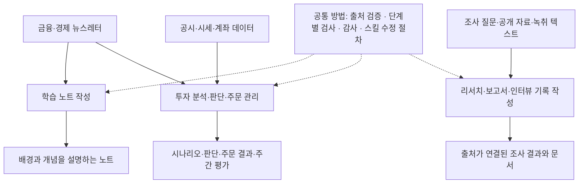

# 학습·투자·리서치에 활용하는 AI 작업 체계

금융·경제 뉴스레터와 공개 자료를 바탕으로 학습 노트, 투자 시나리오와 매매 판단, 컨설팅 조사·보고서를 만드는 AI 작업 체계를 구축해 운영하고 있습니다. Claude Code에 업무별 작업 절차와 판단 기준을 정의하고, Python으로 자료 처리·기록·기계 검사·주문 처리를 구현했습니다. 세 업무는 목적과 결과물이 다르지만, 출처를 원문과 대조하는 방법과 작업 단계마다 산출물을 확인하는 검사 방법을 함께 사용합니다.

이 저장소에서는 현재의 구성, 업무별 작동 방식, 운영 기준, 확인한 범위, 공개용 스킬·코드와 가상 사례를 볼 수 있습니다. 현재 구성의 설명과 코드는 2026년 10월 20일 기준입니다. 운영 사례는 사례마다 적은 날짜 시점의 기록이며, 매매와 평가 사례는 2026년 10월 17일까지의 모의투자 기록에서 가져왔습니다.

## 전체 구성



점선은 같은 방법을 적용한다는 뜻이며, 한 업무가 다른 업무의 선행 단계라는 뜻은 아닙니다. 학습 노트와 투자는 같은 뉴스레터를 읽지만 따로 실행되고, 투자 시스템만 별도의 데이터베이스와 예약 실행을 갖습니다.

| 업무 | 입력 | 처리 | 결과물 |
|---|---|---|---|
| 학습 노트 | 직전 노트 이후 발행된 뉴스레터, 본문에 연결된 원문, 이전 노트 | 다룰 뉴스 선별, 원인·개념 설명, 사실과 해석의 구분, 추가한 사실의 출처 검증, 처음 읽는 사람 기준의 문장 점검 | 사건의 배경과 개념을 이해할 수 있는 노트와 검증 결과 |
| 투자 분석·판단·주문 관리 | 뉴스레터, 공시, 시세·계좌 데이터, 이전 시나리오와 판단 기록 | 산업·기업 영향 분석, 조건부 시나리오, 근거·조건·규모를 갖춘 매수·보유·매도·보류 판단, 주문 규칙 검사, 체결 확인, 주간 평가 | 근거와 조건이 연결된 판단, 주문·체결 상태, 다음 실행에 이어받을 기록 |
| 컨설팅 리서치·문서 작업 | 조사 질문, 공개 자료·공시, 준비된 조사 내용, 화자가 정리된 녹취 텍스트 | 조사 범위 설정, 원문 확인과 출처 대조, 분석·문서 구성, Word·Excel 보고서와 인터뷰 기록 작성, 산출물 검토 | 주장과 근거를 추적할 수 있는 조사 결과, 보고서, 인터뷰 기록 |

**역할 분담.** 저는 업무의 목적과 결과물의 기준을 정하고, 결과를 읽어 문제를 지적하며, 승인 대상으로 정한 변경을 결정합니다. AI 세션은 자료를 읽고 선별·해석·판단안을 쓰며, 단계마다 검사 질문에 근거 파일을 인용해 답합니다. 프로그램은 자료 수집, 상태 저장, 파일·수치 검사, 주문 전송과 체결 확인을 맡습니다. 어디까지 자동으로 처리하는지는 업무마다 다르며, 아래 「운영 기준」에 정리했습니다.

## 실제로 나오는 결과물

- **학습 노트:** 가상 뉴스 한 건을 다룬 노트 발췌입니다. 어떤 사실을 골랐고 그 아래에 어떤 원인·개념 설명을 붙였는지, 원문에 없는 설명을 어떻게 표시하고 검증했는지 볼 수 있습니다. [가상 뉴스 한 건을 검토하는 과정 1부](examples/가상_사례_판단_과정.md#1부-학습-노트)
- **투자 판단과 주문 규칙 검사:** 같은 가상 뉴스에서 시나리오와 매매 조건을 세우고 주문 제안 세 건을 검사한 결과입니다. 사실 등록, 근거 판정, 주문 규칙 검사는 실제 코드를 실행한 출력이며 `bash examples/run_trace.sh`로 재현할 수 있습니다. [2부. 투자 시나리오와 주문](examples/가상_사례_판단_과정.md#2부-투자-시나리오와-주문)

  ```text
  승인 1건 / 거부 2건 → signals/approved_261012_kr.json
    [제안] BUY  900001 한빛전선(가상) x12 @ 24,850.00
    [거부] BUY  900002: 목표 여유 없음 — 기준 수준 resistance_1 12,300이 현재가 12,050 대비 +2.1% (< 바닥 10%) · 바닥을 넘기려고 수준을 바꾸지 않는다
    [거부] BUY  900004: 유니버스 밖 종목 (watchlist 미등재·미보유). watchlist_candidates로 제안할 것
  ```

- **컨설팅 조사와 인터뷰 기록:** 가상 질문에 대한 조사 결과의 출처 표와 인터뷰 기록의 구조를 발췌했습니다. 결론과 근거의 연결, 출처 등급, 발언 귀속이 어떻게 남는지 볼 수 있습니다. [컨설팅 가상 사례](examples/컨설팅_가상_사례.md)

가상 자료로 만든 예시와 실제 코드를 실행한 결과를 각 문서에서 구분해 표시했습니다. 실제 운영 기록의 원본은 공개하지 않습니다.

## 각 업무의 작동 방식

### 학습 노트

`직전 노트 이후 발행분 수집 → 다룰 항목 선별 → 연결된 원문 확인 → 원인·개념 설명 → 처음 읽는 사람 기준의 다시 읽기와 기계 검사 → 추가한 사실의 출처 검증 → 발행 → 감사 결과에 따른 교정`

수집 프로그램이 마지막 수집 시점 이후의 발행분을 한 파일로 모읍니다. AI 세션은 자산 가치·산업 구조·제도에 영향을 주는 항목을 고르고, 각 사실 아래에 원인과 개념을 설명합니다. 원문에 없는 사실에는 `[AI]`, 해석에는 `[추정]`을 붙이고, `[AI]` 문장은 발행 전에 출처와 대조합니다. 완성한 노트는 자료를 읽지 않은 사람의 눈으로 다시 읽어 주어·대상·계산 기준이 빠진 문장을 고치고, 검사 프로그램이 표시 규칙과 금지 표현을 확인합니다. 발행 뒤 감사는 백그라운드에서 진행하며, 판정이 바뀌는 지적만 한 차례 반영합니다.

[학습 노트 시스템](docs/02_학습노트_설명_기준.md)

### 투자 분석·판단·주문 관리

`자료·시장 상태 수집 → 이전 판단 확인 → 산업·기업 영향과 시나리오 분석 → 근거·조건·규모를 갖춘 판단 → 매매 또는 보류 결정 → 주문 전송과 체결 확인 → 마감`

실행마다 여섯 단계를 거치며, 단계가 끝날 때마다 산출 파일과 기록을 검사해야 다음 단계로 갑니다. 조사한 사실은 데이터베이스에 한 번만 등록하고, 분석 노트와 주문 제안은 그 사실의 번호를 가리킵니다. AI 세션이 쓴 주문 제안은 프로그램이 주문 규칙으로 검사해 승인·거부를 정하고, 승인된 주문만 전송합니다. 접수와 체결을 구분해 미체결 주문이 정리될 때까지 실행을 마치지 않습니다. 매주 토요일에는 놓친 상승, 매도 시점, 손실 거래를 당시 기록과 대조해 규칙 변경을 제안하는 피드백을 돌립니다.

[투자 시스템의 분석·판단·실행 흐름](docs/03_투자_시나리오_설계.md) · [운영 결과 평가와 규칙 개선](docs/05_성과_평가_기준.md)

### 컨설팅 리서치·문서 작업

요청에 따라 세 경로 중 하나를 사용합니다. 모든 요청이 한 순서로 실행되지는 않습니다.

| 요청 | 흐름 | 결과 |
|---|---|---|
| 새 조사 질문 | 포함·제외 범위 설정 → 자료 탐색과 원문 확보 → 주장마다 원문 대조와 출처 등급 → 사실과 분석을 나눈 보고서 구성 | 조사 결과 문서와 주장별 출처 |
| 준비된 조사 내용의 문서화 | 내용 구조화 → Word 또는 Excel 형식으로 작성 → 링크·표현·레이아웃 검사 | 검토할 수 있는 보고서·표 |
| 녹취 텍스트 정리 | 화자·참석자 확인 → 논의 흐름에 따른 구조 초안 → 제 확인 → 고유명사·귀속·용어 확인 → 인터뷰 기록 작성 | 발언 취지를 보존한 인터뷰 기록 |

공시 재무 분석, 전문가 답변 정리, 과제 폴더와 자료 위치 관리는 이 경로들을 돕는 도구입니다.

[컨설팅 리서치 시스템](docs/07_컨설팅_리서치_시스템.md)

## 운영 기준

- **사실과 해석을 구분합니다.** 원문에서 확인한 사실, AI가 추가한 사실, 해석을 문장 단위로 표시합니다. 추가한 사실만 출처와 대조하고, 해석은 추정임을 밝힙니다. 투자에서는 주문 근거를 주문 전에 판정하고, 배경 설명은 주문 뒤에도 감사를 이어갑니다. [정보 검증](docs/01_정보_검증.md)
- **이전 판단을 먼저 확인합니다.** 투자 실행은 당일 뉴스를 읽기 전에 이전 시나리오, 대기 중인 매매 조건, 재검토 항목을 확인합니다. 보류할 때도 기다리는 조건을 남겨 이후 결과와 비교합니다. [투자 시나리오](docs/03_투자_시나리오_설계.md)
- **판단과 집행을 분리합니다.** AI 세션은 근거·조건·규모를 갖춘 제안을 쓰고, 프로그램이 매매 대상 목록, 유효시간, 상승 여력 하한, 집중도, 근거 판정 결과 같은 규칙으로 승인·거부를 정합니다. 전송 직전에는 시세를 다시 조회해 전제가 깨진 주문을 보내지 않습니다. [모의투자 기술 문서](ai-trading-bot/README.md)
- **완료는 기록으로 확인합니다.** 작업을 마친 AI가 검사 질문에 파일을 인용해 답하면, 검사 프로그램이 직전 단계의 통과 기록과 산출 파일을 대조합니다. 감사 결과를 언제 기다리고 반영하는지는 업무마다 다릅니다. [단계별 검사](docs/04_단계별_검사.md) · [스킬 운영 원칙](docs/06_스킬_운영_원칙.md)
- **자동 변경과 승인 대상을 나눕니다.** 투자 주간 피드백은 되돌릴 수 있는 변경(판단 규칙 보완, 도구 오류 수정, 매매 대상 추가)만 자동 적용하고 다음 주 지표로 검증합니다. 안전장치와 수치 기준의 변경, 규칙 삭제는 제 승인을 받습니다. 스킬 문서의 문안·구조를 바꾸는 편집도 제 확인을 거칩니다. [성과 평가 기준](docs/05_성과_평가_기준.md)

## 확인한 범위

*2026년 10월 20일 기준*

**운영 중인 범위**

- 학습 노트는 2026년 8월 28일부터 평일마다 작성하고 있습니다.
- 모의투자는 2026년 9월 8일 첫 모의매매 이후 국내·미국 시장에서 운영하고 있으며, 10월부터 예약 실행이 자료 수집부터 분석·검사·주문 판단·체결 확인까지 사람의 개입 없이 수행합니다.
- 주간 피드백은 10월 3일부터 세 차례 진행했고 매주 토요일 예약 실행합니다. 이 과정에서 매매 대상 선정 기준을 두 차례 수정했습니다.
- 컨설팅 스킬은 2026년 6월부터 조사 업무에 사용해 왔고, 그 출처 검증 방법과 검사 엔진을 8~9월에 학습 노트와 모의투자에 재사용했습니다.

**구현과 재현으로 확인한 범위**

- 투자 시스템의 테스트 파일 14개는 주문 규칙, 주문 전송 경로, 주문 근거 판정, 데이터베이스 저장과 이전, 보고 계산의 동작을 가짜 증권사 연결과 임시 데이터베이스로 확인합니다. 분석의 정확도나 수익성을 재는 테스트는 아닙니다.
- 가상 사례의 사실 등록, 근거 판정, 주문 규칙 검사는 공개 코드를 실제로 실행한 결과입니다.

**아직 평가 중인 범위**

- 뉴스에서 세운 시나리오가 적절한 종목 선정과 매매로 이어지고 수익성이 있는지는 계속 확인하고 있습니다. 매매 대상 기준 변경으로 이전에 제외됐던 종목이 편입된 것은 확인했으나, 실제 매수와 수익성 개선은 확인하지 못했습니다. 10월 17일 피드백은 이 변경을 포함한 지표 14개의 판정을 적용 뒤 표본이 쌓이는 10월 24일로 미뤘고, 지표 9개는 유지로 판정했습니다.
- 공개 설정은 모의계좌 모드로 고정했습니다. 실제 계좌 정보, 자금 규모, 성과 수치, 계좌 모드의 변경 여부는 공개하지 않습니다.

**공개 자료로 확인하는 방법**

```bash
python3 ai-trading-bot/run_tests.py                         # 테스트 14개 파일 — 네트워크·증권사 키 없이
bash examples/run_trace.sh                                   # 가상 사례의 사실 등록 → 근거 판정 → 주문 규칙 검사 재현
python3 .claude/skills/_shared/check_skill_integrity.py      # 스킬 이름·검사 기준표·경로 정합
python3 tools/skill_graph.py --check                          # 스킬 구성 참고 자료가 파일과 같은지
```

## 왜 이런 기준을 선택했는가

현재 기준을 이해하는 데 도움이 되는 사례를 골랐습니다. 제 요구와 결정, 시스템의 분석과 구현, 확인된 결과를 구분해 적었습니다.

**설명이 충분한 노트의 기준.** 초기 노트에는 뉴스의 사실이 정리돼 있었지만 읽고 나면 사건이 왜 일어났는지 다시 찾아야 했습니다. 저는 사실 나열로 채워진 노트는 요약과 다르지 않다고 지적하고, 주요 사실 아래에 원인과 작동 과정을 설명하도록 기준을 보완했습니다. 용어도 정의에 더해 제도의 목적과 해당 뉴스에서의 의미를 설명하게 했습니다. [학습 노트의 설명 기준](docs/02_학습노트_설명_기준.md)

**주문 전 판정과 주문 후 감사의 분리.** 10월 13일 감사가 반복되는 동안 약 5시간이 지나 주문 제안의 유효시간을 넘겼고 제안된 주문이 모두 거부됐습니다. 저는 주문에 필요한 근거 확인은 먼저 하고 감사는 주문 뒤에도 이어가도록 변경을 요청했습니다. 감사 결과 매수 근거가 성립하지 않는 것으로 바뀌면 해당 매수분을 매도합니다. [정보 검증](docs/01_정보_검증.md)

**교정이 다른 기록에 반영되지 않는 문제.** 출처 검증에서 사실을 고쳐도 분석 노트와 주문안에는 이전 내용이 남는 일이 반복됐습니다. 저는 10월 7일 감사에서 반복되는 오류를 단계별 검사에 반영하도록 요구했고, 검사 질문을 추가한 뒤에도 누락이 이어지자 시스템은 10월 13일 관련 문서를 직접 대조하는 프로그램을 추가해 이후 실행에서 제출 전 누락 3건을 찾았습니다. 10월 17일에는 사실을 데이터베이스에 한 번만 저장하고 노트와 주문안이 그 번호를 가리키는 구조로 바꿔, 교정을 여러 사본에 옮길 필요 자체를 없앴습니다. [정보 검증](docs/01_정보_검증.md) · [스킬 운영 원칙](docs/06_스킬_운영_원칙.md)

**매매하지 않은 판단의 평가.** 10월 2일 주요 종목의 상승을 놓친 사례를 보고, 저는 매수하지 않은 이유와 당시 무엇을 검토했어야 하는지 분석하고 필요하면 규칙까지 수정하도록 요구했습니다. 시스템은 이미 수혜 후보로 분석한 종목이 매매 대상 선정 기준 때문에 제외되는 문제를 찾았고, 저는 허용 시장 확대와 시가총액 하한 조정을 승인했습니다. 변경 효과는 적용 뒤 사건만으로 다시 재도록 했으며, 판정은 10월 24일로 미뤄져 있습니다. [성과 평가 기준](docs/05_성과_평가_기준.md)

**테스트가 통과했는데 주문 전송이 실패한 이유.** 10월 12일 코드 수정에서 증권사 호출 결과를 저장하는 한 줄이 빠졌지만 기존 테스트는 통과했습니다. 사고 분석에서 해당 함수를 호출하는 테스트가 없었음이 확인됐고, 시스템은 코드에서 사라진 줄을 찾는 검사와 가짜 증권사 연결로 전송부터 체결 확인까지 돌리는 테스트를 추가했습니다. 같은 줄을 다시 지운 재현에서 이 테스트가 누락을 발견했습니다. [스킬 운영 원칙](docs/06_스킬_운영_원칙.md)

## 더 자세히 볼 곳

**설명 문서**

| 문서 | 내용 |
|---|---|
| [전체 구성과 역할 분담](docs/00_프로젝트_배경과_설계.md) | 세 업무의 관계, 운영자·AI·프로그램의 역할, 용어, 개발 배경 |
| [정보 검증](docs/01_정보_검증.md) | 출처·사실 확인 방법과 업무별 적용. 투자 시스템의 사실 기록·판정·문서 생성 구조 |
| [학습 노트 시스템](docs/02_학습노트_설명_기준.md) | 선별, 설명, 다시 읽기, 검증, 발행의 기준 |
| [투자 시스템의 분석·판단·실행 흐름](docs/03_투자_시나리오_설계.md) | 영향 분석, 시나리오, 매매 조건, 실행, 이어받기 |
| [단계별 검사](docs/04_단계별_검사.md) | AI와 프로그램의 검사 역할, 단계 간 조건, 중단·재개, 완료 확인 |
| [성과 평가 기준](docs/05_성과_평가_기준.md) | 투자 시스템의 평가 대상, 주간 피드백, 자동 적용·승인 범위 |
| [스킬 운영 원칙](docs/06_스킬_운영_원칙.md) | 공통 방법의 재사용, 업무별 감사·완료 조건, 스킬 수정 절차 |
| [컨설팅 리서치 시스템](docs/07_컨설팅_리서치_시스템.md) | 요청 유형별 처리 경로, 산출물, 검토 지점 |
| [스킬 구성 참고 자료](docs/reference/스킬_구성.md) | 스킬 17개의 역할, 검사 지점, 참조 관계 |

**가상 사례와 코드**

- [가상 뉴스 한 건을 검토하는 과정](examples/가상_사례_판단_과정.md) · [컨설팅 가상 사례](examples/컨설팅_가상_사례.md)
- [모의투자 기술 문서](ai-trading-bot/README.md): 실행 방식, 주문 검사, 데이터베이스 구조, 테스트
- [뉴스레터 처리 도구 기술 문서](gmail-newsletter-analyzer/README.md): 수집, 노트 검사, 파일 정리
- 스킬 문서는 [.claude/skills/](.claude/skills/)에 있습니다. 일상·투자 6개, 컨설팅 9개, 스킬 수정·감사 2개이며, 검사 엔진과 공용 스크립트는 `_stepgate/`·`_shared/`에 있습니다.

## 공개 범위

설계 설명, 공개용으로 정리한 스킬·코드, 가상 사례를 제공합니다. 개인 학습 노트, 구독 뉴스레터 원문, 실제 분석·매매 기록과 데이터베이스, 계좌 정보와 인증 정보는 포함하지 않습니다. 운영 사례는 현재 기준을 설명하는 데 필요한 범위로 요약했습니다. 컨설팅 스킬의 펌 이름, 고객사와 과제 이름, 인터뷰 대상과 전문가의 실명, 이메일은 일반어와 자리표시자로 바꿨고, 실제 회의록·서식 가이드·소속 조직의 운영 도구·브랜드 디자인 규격·검사 기록 파일은 제외했습니다.

## English

I build and operate Claude Code workflows for three kinds of work: learning notes from financial newsletters, investment analysis with order management, and consulting research and document production. I define the purpose and the output standards for each workflow, review the results, and decide on changes that require approval. AI sessions select, interpret, and draft judgments; Python programs collect data, keep state, perform mechanical checks, and handle orders. The workflows share source verification and stage-by-stage checks, while each keeps its own procedures. This repository describes the current system, how each workflow operates, what has been verified so far, and includes public skills, code, and synthetic walkthroughs. Account details, fund sizes, and performance figures are not disclosed.

## License

[MIT](LICENSE)
