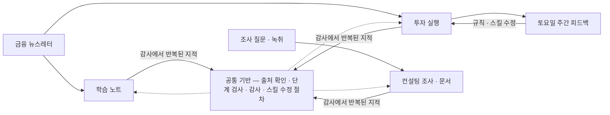

# 뉴스레터 하나로 공부와 투자를, 같은 방법으로 조사와 보고서를

평일 아침 9시 30분에 국내 주식 투자 실행이, 11시에 그날의 학습 노트가, 밤 10시 35분에 미국 주식 투자 실행이, 토요일 아침에 한 주의 투자 평가가 제 컴퓨터에서 저절로 돌아갑니다. 그 시각에 저는 자리에 없습니다. 각 작업은 제가 Claude Code에 파일로 적어 둔 작업 절차와 판단 기준(이 저장소에서는 '스킬'이라고 부릅니다)을 예약 작업이 정해진 시각에 호출해 실행합니다.

이 체계는 컨설팅 리서치에서 시작했습니다. 2026년 6월부터 조사·보고서·인터뷰 기록 작업에 AI를 쓰면서 "1차 작업과 1차 검수는 AI가, 목표·기준·최종 판단은 제가" 맡도록 일을 나누는 방식과 그 도구를 만들었고, 8~9월에 같은 방식을 금융 뉴스레터 학습 노트와 모의투자(증권사 모의계좌로 하는 매매)로 넓혔습니다.

이 문서는 세 가지를 보여 줍니다. 제가 스킬들을 어떻게 함께 쓰고 있는지, 그래서 무엇이 나오고 제게 어떤 이점이 있는지, 그리고 어떤 문제의식과 시행착오를 거쳐 여기까지 왔는지입니다.

## 1. 큰 그림 — 스킬을 함께 쓰는 방식

뉴스레터 한 통이 어떻게 도는지 따라가면 전체가 보입니다. 평일 11시, 학습 노트 스킬이 직전 노트 이후 발행된 뉴스레터를 모아 다룰 항목을 고르고 각 사실 아래에 원인과 개념을 설명한 노트를 씁니다. 원문에 없는 설명을 덧붙였으면 표시를 달고, 출처 확인 스킬이 그 문장을 원문과 대조합니다.

같은 뉴스레터는 그날 투자 실행의 재료이기도 합니다. 투자 실행 스킬은 이전에 세워 둔 시나리오를 먼저 확인한 뒤 뉴스를 읽고, 어떤 사건이 어느 산업과 기업에 영향을 줄지 분석해 조건이 붙은 매수·매도·보류 판단을 주문 제안으로 적습니다. 프로그램이 그 제안을 주문 규칙으로 검사해 승인·거부를 정하고, 승인된 주문만 보내 체결을 확인합니다.

토요일에는 주간 피드백 스킬이 그 주의 놓친 상승, 매도 시점, 손실 거래, 사지 않은 판단을 당시 기록과 대조해 규칙 변경을 제안합니다. 되돌릴 수 있는 변경은 스킬 수정 절차로 바로 반영돼 다음 월요일 실행에 들어가고, 안전장치나 수치 기준의 변경은 제 승인을 기다립니다. 스킬이 스킬을 고치는 되먹임이 매주 한 번 돕니다.



| 언제 | 무엇이 도는가 | 무엇이 나오는가 |
|---|---|---|
| 평일 09:30 | 국내 투자 실행(여섯 단계) | 분석 노트, 주문 제안, 승인·거부 결과, 주문·체결 기록 |
| 평일 11:00 | 학습 노트 | 그날의 노트, 덧붙인 사실의 출처 검증 결과 |
| 평일 22:35 | 미국 투자 실행 | 국내와 같은 기록 |
| 토요일 | 주간 피드백 | 놓친 상승·매도 시점·손실 판정, 규칙 변경 제안과 적용 기록 |
| 필요할 때(컨설팅 재직 중) | 조사 · Word·Excel 보고서 · 인터뷰 기록 | 주장마다 출처가 붙은 조사 결과와 문서 |

세 업무는 네 가지를 공유합니다. 출처 확인은 덧붙인 주장을 원문과 대조해 일치·불일치·시효 지남·확인 불가로 판정하는 절차입니다. 단계 검사는 작업 단계가 끝날 때마다 AI가 검사 질문에 답하고 프로그램이 산출 파일을 대조하는 관문입니다. 감사는 통과한 산출물을 별도의 AI가 다시 읽는 절차이고, 스킬 수정 절차는 스킬 파일을 고칠 때 편집 전후를 대조하고 테스트를 다시 돌리는 규칙입니다. 네 가지 모두 컨설팅에서 먼저 만들었습니다.

역할은 셋으로 나뉩니다. 저는 업무의 목표와 결과물의 기준을 정하고, 결과를 읽어 문제를 지적하며, 승인 대상으로 정한 변경을 결정합니다. AI 세션은 자료를 읽고 선별·해석·판단안을 쓰고 검사 질문에 근거 파일을 인용해 답합니다. 프로그램은 자료를 모으고 상태를 저장하며 파일·수치를 검사하고 주문을 보냅니다. 예를 들어 주문의 승인·거부는 AI가 아니라 프로그램이 규칙으로 정합니다.

맡기되 근거는 이해하고 넘어간다는 것이 제가 지키는 선입니다.

무엇이 운영 중이고 무엇이 평가 중인지는 아래 「확인한 것과 한계」에 적었습니다. 스킬 사이의 호출 관계와 공통 기반의 구조는 [큰 그림 — 스킬을 함께 쓰는 방식](docs/01_큰_그림_스킬을_함께_쓰는_방식.md)에 있습니다.

## 2. 결과물과 제게 주는 이점

이점은 세 종류입니다. 제가 안 해도 되는 일, 제가 새로 얻게 된 것, 그리고 다음 일이 지난 일의 결론 위에서 시작하는 것입니다.

### 투자 — 예상해 둔 조건에 대응하고, 사지 않은 이유까지 남습니다

저는 뉴스를 보고 사는 대신, 앞으로 일어날 일을 예상해 두고 그 일이 생기면 정해 둔 조건대로 대응하도록 했습니다. 실행 중에 제가 결정할 자리는 없습니다. 주문을 낼지, 얼마나 낼지, 손절선에 닿으면 팔지는 규칙과 기록이 정하므로 제가 병목이 되지 않습니다. 사지 않은 판단과 그 이유까지 기록되기 때문에 매주 제 가설이 점검됩니다.

가상 사례에서 주문 제안 세 건을 실제 코드로 검사한 결과입니다.

```text
승인 1건 / 거부 2건 → signals/approved_261012_kr.json
  [제안] BUY  900001 한빛전선(가상) x12 @ 24,850.00
  [거부] BUY  900002: 목표 여유 없음 — 기준 수준 resistance_1 12,300이 현재가 12,050 대비 +2.1% (< 바닥 10%) · 바닥을 넘기려고 수준을 바꾸지 않는다
  [거부] BUY  900004: 유니버스 밖 종목 (watchlist 미등재·미보유). watchlist_candidates로 제안할 것
```

두 번째 제안은 목표 가격이 현재가보다 2.1%밖에 높지 않아 거부됐습니다. 상승 여력 10%는 제가 정한 하한입니다. 세 번째는 뉴스레터의 권유 문장을 근거로 올라온 종목인데 매매 대상 목록에 없어 거부됐습니다. 거부 사유가 그대로 기록으로 남습니다. 승인된 제안에는 근거가 된 사실의 번호, 목표 기준, 철회 조건이 함께 적힙니다.

2026년 9월 9일부터 10월 20일까지 실행 52회(국내 25·미국 27), 거래 기록 45일, 주간 피드백 3회가 쌓였습니다. 뉴스에서 세운 시나리오가 적절한 종목 선정과 수익으로 이어지는지는 아직 평가 중이며, 계좌 성과는 공개하지 않습니다.

### 학습 노트 — 끊겼던 공부가 이어집니다

2026년 1월부터 3월까지 저는 뉴스레터를 읽고 사실 아래에 원인과 개념을 덧붙이는 노트를 손으로 썼습니다. 바빠지면서 끊긴 이 공부를 8월 28일부터 평일마다 AI가 이어 가고 있습니다. 요약이 아니라 "왜 그런가"가 적힌 노트가 36편 쌓였습니다. 가상 뉴스로 만든 노트의 한 항목입니다.

- 한빛전선이 해상풍력 2단계에 해저 HVDC 케이블 1,200억 원어치를 공급하는 계약을 체결했고 주가가 9.8% 올랐다. (월요 경제 브리프)
  - 해상풍력으로 생산한 전기를 육지로 보내려면 장거리 해저 송전 설비가 필요하다.
  - HVDC(초고압 직류 송전)는 장거리에서 교류보다 송전 손실이 적어 해저 송전에 사용하는 방식이다. (원문 각주)
  - 국내 조달 의무 비율이 도입되면 발주처의 자재 단가가 오를 수 있다. `[추정]`

사실 한 줄 아래에 왜 그 설비가 필요한지, 용어가 무엇인지, 어디까지가 해석인지가 구분돼 있습니다. 원문에 없는 사실에는 표시가 붙고 발행 전에 출처와 대조됩니다. 노트의 설명이 충분한지는 제가 읽으며 평가하며, 이를 수치로 잰 결과는 없습니다.

### 컨설팅 조사 — 포기하던 것을 포기하지 않게 됐습니다

조사 업무에는 시간·정확성·깊이·범위·판단이 동시에 걸려 있어, 저는 과제마다 무엇을 포기할지 고르고 있었습니다. 탐색·1차 정리·출처 대조를 AI에 맡기자 그 시간을 깊이·범위·검증에 다시 쓸 수 있었습니다. 산출물의 주장마다 출처와 원문 인용이 붙어 검토자가 바로 대조할 수 있습니다. 가상 조사 결과의 출처 한 줄과, 완성된 문서를 감리한 교정 지시서 한 줄입니다.

| 수치 | 의미 | 출처 |
|---|---|---|
| 2027년 1월 1일 시행 · 2027년 40%, 2028년 60% | 시행일과 국내 조달 의무 비율의 연도별 적용 조건 | [R1] |

| 위치 | 현재 텍스트 | 조치 | 근거 |
|---|---|---|---|
| 2절 셋째 문단 | "2027년부터 국내 조달 비율 60%가 적용된다" | "2027년 40%, 2028년 60%"로 수정 (🟡 수정 권고) | [R1] 원문은 연도별 비율을 구분한다. 조건이 빠진 인용은 불일치로 처리한다. |

이 스킬들은 제가 혼자 쓰는 데서 그치지 않도록 다른 사람도 쓸 수 있는 형태로 표준화해 사용 가이드와 함께 소속 조직에 배포했습니다. 실제 과제와 고객 정보는 공개하지 않으며, 사용 인원이나 절감 시간을 잰 자료는 없습니다.

### 공통 — 다음 일이 지난 일의 결론 위에서 시작합니다

한 과제에서 얻은 교정과 규칙은 스킬·메모리·기록에 남겨 다음 과제가 그 위에서 시작하게 했습니다. 감사에서 반복된 지적은 검사 문항으로 올라갑니다. 2026년 9월 28일 이후 감사 지적 123건 중 74건이 그렇게 검사 문항이 됐습니다. 과제를 거듭할수록 출발점이 조금씩 높아지는 것이 이 방식의 핵심입니다.

## 3. 어떻게 만들 수 있었나 — 생각의 줄기 다섯

시간순입니다. 각 줄기는 제가 본 문제, 제가 정한 것, 시행착오, 그리고 지금 남아 있는 산출물로 이어집니다.

### 검증은 컨설팅에서 시작했습니다 (2026년 6~7월)

AI가 만든 조사 산출물은 초안 수준이었고, 어떤 주장이 어디서 나왔는지 추적할 수 없었습니다. 그대로는 검토자에게 넘길 수 없었습니다.

저는 내부 자료 대신 외부의 확실한 출처만 인용하고, 작업 중 붙인 표식을 산출물에서 전부 빼며, "어떤 품질이 왜 부족한지"를 정의해 그 기준으로 피드백하도록 했습니다. 도구를 완성한 뒤 쓰는 것이 아니라 쓰면서 완성하기로 하고, 값 하나를 고치는 대신 그 값을 낳은 전제와 구조를 바꾸는 피드백을 반복했습니다.

처음 세 주는 형식과 가독성을 고치는 데 썼습니다. 표 틀을 고정한 첫 버전은 실제 자료를 넣자 읽히지 않았고, 열 너비를 내용에 맞추도록 바꾼 뒤에야 쓸 수 있었습니다. 시스템은 검색 결과의 요약을 인용하지 않고 원문을 확보해 주장마다 대조하는 절차, 출처 등급, 작성자와 검토자의 분리, 단계 검사 엔진으로 이를 구현했습니다.

이 검증 절차와 검사 엔진이 이후 학습 노트와 투자에 그대로 재사용됐습니다. [컨설팅 조사 — 검증은 여기서 시작했다](docs/05_컨설팅_조사_검증은_여기서_시작했다.md) · [컨설팅 가상 사례](examples/컨설팅_가상_사례.md)

### 요약이 아니라 이해 (2026년 8~9월)

제가 손으로 쓰던 노트는 사실 아래에 원인과 개념을 적는 방식이었습니다. AI가 쓴 초기 노트는 사실을 나열했고, 저는 요약만 할 거면 이 도구를 쓸 이유가 없다고 봤습니다. 법의 정의는 적혀 있어도 그 법 때문에 기업이 왜 그렇게 움직였는지는 빠져 있었습니다.

저는 주요 사실 아래에 원인과 작동 과정을 설명하고, 용어는 무엇인지·왜 그런 규칙이 생겼는지·이 뉴스와 무슨 관계인지까지 적도록 요구했습니다. 시스템은 제가 쓴 노트 177개 항목을 뉴스레터 원문 57통과 대조해 선별 기준과 설명 방식을 규칙으로 옮겼습니다.

시행착오는 세 번 있었습니다. 과거 노트의 통계를 참고로 넣자 AI가 그 숫자에 맞춰 항목을 채웠고, 저는 9월 7일 선별 건수에 의미를 두지 말라고 정했습니다. 

9월 15일 노트 오류 세 건을 노트에서만 고치려 하기에, 저는 사례가 아니라 그 사례가 나온 원인을 분석해 스킬 자체를 고치라고 요구했습니다. 9월 28일에는 스킬 문서의 말투가 노트에 그대로 묻어난 것을 지적했습니다. 시스템은 자료를 읽지 않은 사람의 눈으로 다시 읽는 단계, 기계 검사, 문체 분리로 구현했습니다.

평일 노트 36편과 그 작성 규칙이 남아 있습니다. [학습 노트 — 요약이 아니라 이해](docs/02_학습_노트_요약이_아니라_이해.md) · [가상 뉴스 한 건을 검토하는 과정 1부](examples/가상_사례_판단_과정.md#1부-학습-노트)

### 뉴스를 보고 사는 게 아니라, 예상해 두고 대응합니다 (2026년 9월)

뉴스레터로 소식을 듣는 시점은 시장보다 하루 이틀 늦습니다. 9월 8일 첫 실행을 앞두고 저는 늦은 정보로 매매하는 것이 의미가 있는지 먼저 물었고, 우위는 속도가 아니라 예정된 일을 미리 파악해 시나리오를 짜 두는 데서 나온다고 정했습니다.

저는 세 가지를 요구했습니다. 종목마다 무엇이 일어나면 사고 무엇이 깨지면 팔지를 조건과 철회 조건으로 미리 적을 것, 국내와 미국 시장을 같은 주제로 묶어 한 흐름으로 볼 것, 날짜가 정해진 사건은 피할 일이 아니라 미리 자리를 잡아 둘 일로 다룰 것입니다. 시스템은 이전 시나리오를 먼저 확인한 뒤 당일 뉴스를 읽는 순서로 구현했습니다.

첫 실행은 상황을 더 봐야 한다며 매매를 미뤘습니다. 저는 언젠가는 결단을 내려야 한다고 요구했고, 보류는 견해가 서지 않을 때만 쓰게 했습니다. 

9월 16일 현금 비율이 80%를 넘긴 것을 보고 저는 이 상태를 투자라 할 수 없다고 지적했으며, 손절 조건에 닿았으면 되묻지 말고 팔라고 정했습니다. 시스템은 처음에 최소 거래 건수와 현금 비율을 고정값으로 두었지만, 9월 22일 저는 고정 숫자에 맞추는 매매라면 AI를 쓸 이유가 없다고 되돌렸습니다. 이후 비율은 그날의 판단이 정하고 이전 실행의 판단을 이어받습니다.

10월 3일 저는 상승 여력 10%가 목표가 아니라 하한이라고 정했고, 10월 15일 손절 뒤 현금이 늘어난 것을 보고 같은 실행 안에서 다시 투자하도록 했습니다. 실행 52회와 거래 기록 45일, 조건과 철회 조건이 적힌 판단 기록이 남아 있습니다. [투자 — 예상해 두고 대응한다](docs/03_투자_예상해_두고_대응한다.md) · [가상 사례 2부](examples/가상_사례_판단_과정.md#2부-투자-시나리오와-주문)

### 했다는 말을 믿지 않습니다 — 작업도, 수정도 (2026년 9~10월)

단계마다 검사를 통과해야 다음 단계로 넘어가는 체계는 제가 설계했습니다. 그러나 초기 투자 실행은 분석 노트를 다 쓴 뒤에만 검사했고, 자료가 덮어써지거나 뉴스레터를 끝까지 읽지 않은 사고는 그 앞에서 났습니다. 검사는 하나도 잡지 못했고 전부 제가 결과를 읽다가 발견했습니다. 9월 9일 저는 요구한 것이 말없이 빠지는 일을 지적했고, 이후 요구 사항은 대조표로 남겨 기계로 확인합니다.

시스템은 여섯 단계 사이마다 관문을 두고, 검사 질문과 판정 기준을 분리하며, AI의 답을 파일에서 대조하는 방식으로 구현했습니다. 

감사를 관문으로 두자 다른 문제가 생겼습니다. 하루 10시간을 감사 반복에 쓴 날이 있었고, 10월 13일에는 주문 전 감사가 다섯 시간 걸려 주문 제안의 유효시간이 지나 전량 거부됐습니다. 저는 감사가 끝나야 매매하는 것은 과하다고 보고, 감사는 두 번까지, 반복되는 지적만 검사 문항으로 올리고, 주문 전에는 판정표로 결정하되 감사는 주문 뒤에 이어 가고 결론이 뒤집히면 해당 매수분을 되팔도록 정했습니다.

수정도 같은 원칙입니다. 9월 1일 정해 둔 절차 없이 스킬을 고친 일을 지적했고, 9월 9일 설명문의 형식 오류로 스킬 다섯 개가 도구 목록에서 사라졌습니다. 

10월 12일에는 코드 수정에서 주문 전송 한 줄이 빠졌는데 기존 테스트 130건이 통과해 다음 날 주문이 0건으로 끝났습니다. 저는 코드 수정에도 감사가 있어야 한다고 요구했고, 시스템은 편집 전후의 누락 대조, 코드 편집 검사, 가짜 증권사로 전송부터 체결까지 돌리는 테스트로 구현했습니다. 같은 줄을 다시 지운 재현에서 이 테스트 11건 중 6건이 실패했습니다.

검사 엔진, 감사 지적을 검사 문항으로 올린 기록, 스킬 수정 절차가 남아 있습니다. [검사와 감사 — 했다는 말을 믿지 않는다](docs/04_검사와_감사_했다는_말을_믿지_않는다.md)

### 사례가 아니라 원인을 고칩니다 (2026년 10월)

10월 2일 주요 종목의 상승을 놓친 것을 보고, 저는 사지 않은 이유와 당시 무엇을 평가했어야 했는지를 시스템 스스로 피드백하고 필요하면 스킬까지 고치도록 요구했습니다. 그전까지 규칙은 제가 지적할 때만 바뀌었습니다.

시스템은 토요일 피드백으로 구현했습니다. 종목마다 당시 자료로 다르게 할 수 있었던 결함인지, 규칙이 위험을 막은 맞은 판단인지, 단서가 없었던 운인지를 가르고, 결함에 대해서만 유형 단위로 변경을 제안합니다. 저는 되돌릴 수 있는 변경은 자동 적용하고 안전장치·수치 기준·규칙 삭제는 제 승인을 받는 권장안을 채택했습니다.

세 사례가 이 원칙을 보여 줍니다. 분석에 수혜 후보로 나온 종목이 매매 대상 편입 기준에 막혀 오른 뒤에야 들어오는 문제가 두 차례 확인됐고, 저는 편입 기준 변경을 승인하되 급등한 뒤 추격 매수를 거부한 판단은 유지했습니다. 변경 효과는 적용 뒤 사건만으로 재도록 해 판정이 미뤄져 있습니다. 

10월 17일 시스템이 여러 종목이 함께 하락하면 매수를 일괄 중단하자고 제안했을 때, 저는 하락한 원인을 찾아 저점 매수인지 손절인지 판단해야지 방향을 미리 정해서는 안 된다고 거부했습니다.

교정한 사실이 다른 문서에 반영되지 않는 문제는 검사 질문 추가(10월 7일)와 대조 프로그램(10월 13일, 누락 3건 발견)을 거쳐도 반복됐습니다. 

저는 10월 17일 모든 사실을 한 곳에 두고 검증을 중복하지 않으며 AI는 조사와 판단만 맡도록 정했고, 설계안은 세 차례 반려한 뒤 받아들였습니다. 지금은 사실, 판단, 주문이 번호로 이어진 저장소 하나와 주간 피드백 3회의 기록이 남아 있습니다. [투자 — 주간 피드백](docs/03_투자_예상해_두고_대응한다.md#주간-피드백) · [검사와 감사](docs/04_검사와_감사_했다는_말을_믿지_않는다.md)

## 확인한 것과 한계

- **운영 중:** 학습 노트(2026년 8월 28일부터 평일), 모의투자 실행(9월 9일부터 국내·미국, 10월부터 예약 실행으로 사람의 개입 없이), 주간 피드백(10월 3일부터 매주 토요일). 컨설팅 스킬은 2026년 6월부터 재직 중에 썼습니다.
- **구현과 재현으로 확인:** 투자 코드의 테스트 14개 파일(가짜 증권사와 임시 데이터베이스), 가상 사례의 사실 등록·근거 판정·주문 규칙 검사 재현(`bash examples/run_trace.sh`).
- **평가 중:** 시나리오가 종목 선정과 수익으로 이어지는지, 매매 대상 기준 변경의 효과(적용 뒤 사건만으로 재며 판정을 미룬 상태).
- **공개하지 않는 것:** 계좌 정보, 자금 규모, 성과 수치, 계좌 모드의 변경 여부, 고객사·과제·실명, 실제 노트·매매 기록·데이터베이스, 실제 회의록과 서식. 예시의 기업·사건·수치는 가상이며, 실제 코드를 실행한 부분은 그렇게 표시했습니다.

## 더 볼 곳

| 문서 | 내용 |
|---|---|
| [큰 그림 — 스킬을 함께 쓰는 방식](docs/01_큰_그림_스킬을_함께_쓰는_방식.md) | 일주일 리듬, 스킬 사이의 호출 관계, 공통 기반, 역할, 성장 연표 |
| [학습 노트 — 요약이 아니라 이해](docs/02_학습_노트_요약이_아니라_이해.md) | 선별·설명·다시 읽기·검증·발행의 기준과 그 기준을 정한 과정 |
| [투자 — 예상해 두고 대응한다](docs/03_투자_예상해_두고_대응한다.md) | 시나리오·매매 조건·주문 규칙·주간 피드백·사실 저장소 |
| [검사와 감사 — 했다는 말을 믿지 않는다](docs/04_검사와_감사_했다는_말을_믿지_않는다.md) | 단계 검사, 감사 지적을 검사 문항으로 올리는 방식, 스킬 수정 절차 |
| [컨설팅 조사 — 검증은 여기서 시작했다](docs/05_컨설팅_조사_검증은_여기서_시작했다.md) | 조사·문서·인터뷰 기록의 세 경로와 제가 확인하는 자리 |
| [스킬 구성 참고 자료](docs/reference/스킬_구성.md) | 스킬 17개의 역할, 검사 지점, 참조 관계(자동 생성) |

가상 사례는 [가상 뉴스 한 건을 검토하는 과정](examples/가상_사례_판단_과정.md)과 [컨설팅 가상 사례](examples/컨설팅_가상_사례.md)에, 실행 방법과 코드 구조는 [모의투자 기술 문서](ai-trading-bot/README.md)와 [뉴스레터 처리 도구 기술 문서](gmail-newsletter-analyzer/README.md)에 있습니다.

스킬 파일은 [.claude/skills/](.claude/skills/)에 있습니다. 일상·투자 6개, 컨설팅 9개, 스킬 수정·감사 2개이며 검사 엔진과 공용 스크립트가 함께 있습니다.

## English

One financial newsletter feeds two outputs: a learning note that explains why things happened, and a paper-trading cycle that acts on scenarios prepared in advance. Both reuse the source-verification and stage-check methods I first built for consulting research. Weekday cycles and a Saturday review are scheduled jobs; I set the goals and standards, read the results, and approve the changes that need approval, while AI sessions draft judgments and programs collect data, check files, and handle orders. This repository shows how the skills work together, what comes out of them, and the problems and trial-and-error behind each design choice. Account details, fund sizes, and performance figures are not disclosed.

## License

[MIT](LICENSE)
