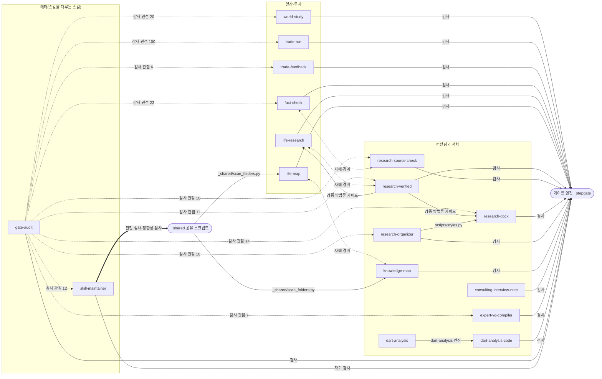

# 여러 프로젝트에 같은 원칙을 적용해 스킬을 운영한 과정

학습 노트와 모의투자로 시작한 작업은 컨설팅 리서치로 넓어졌고, Claude Code 스킬은 17개가 됐습니다. 스킬이 늘면서 생긴 문제는 개별 스킬의 품질이 아니라 스킬 사이의 관계에서 나왔습니다. 고치다가 줄이 빠지고, 이름을 바꾸다가 검사가 죽고, 같은 지적이 실행마다 되풀이되고, 비슷한 스킬이 서로의 영역을 침범했습니다.

저는 새 스킬을 더 만들기 전에 스킬을 고치고 검사하는 절차부터 정했습니다. 이 글은 그 판단이 어떤 사건에서 나왔고, 어떤 구조로 구현됐으며, 무엇이 확인됐고 무엇이 한계로 남았는지를 설명합니다. 근거는 전부 이 저장소의 스킬 파일에 있습니다.

## 1. 스킬을 고치는 절차부터 만든 이유

2026년 8월 21일, 스킬 폴더 이름과 머리말의 이름이 어긋나거나 이름을 바꾼 뒤 검사 기준표가 옛 이름으로 남아 검사가 조용히 멈추는 일이 잇따랐습니다. 9월 9일에는 설명문에 들어간 쌍점 하나 때문에 스킬 5개가 아무 오류 표시 없이 도구 목록에서 사라졌습니다. 앞서 위치를 옮겨 고치려던 시도는 원인을 잘못 짚은 것이었습니다([정합성 검사 머리말](../.claude/skills/_shared/check_skill_integrity.py#L7)). 10월 12일에는 주문 전송 코드의 블록을 바꿔 쓰는 과정에서 전송 한 줄이 빠졌는데, 문법 검사와 테스트 130건은 그 뒤에도 통과했습니다([편집 사고 기록](../.claude/skills/skill-maintainer/SKILL.md#L87)).

세 사건의 공통점은 "고쳤다"는 보고와 실제 상태가 달랐다는 것입니다. 저는 스킬을 고치는 일 자체를 하나의 절차로 만들고, 그 절차가 세 가지를 보장하도록 요구했습니다. 고치기 전 상태로 되돌릴 수 있을 것, 무엇이 빠졌는지를 사람이 아니라 기계가 줄 단위로 대조할 것, 고친 뒤 테스트가 끝까지 실행됐는지 기록으로 남을 것입니다.

시스템은 이를 `skill-maintainer` 스킬로 구현했습니다. 편집 전 날짜가 붙은 백업을 만들고, 편집 전후를 줄 단위로 대조해 사라진 줄을 보고하며, 코드 편집은 전용 검사와 테스트 실행 기록을 거치고, 마지막에 모든 스킬의 이름·검사 기준표·인용 경로가 맞는지 정합성 검사를 돌립니다. 이 스킬도 자기 검사 지점을 통과해야 끝납니다([검사 지점 verify](../.claude/skills/skill-maintainer/SKILL.md#L19)).

한계도 절차 안에 적어 두었습니다. 백업 파일은 저장소 이력을 대신하지 못하므로, 되돌릴 수 있어야 하는 편집 전에는 그 폴더가 버전 관리 중인지 먼저 확인합니다([백업의 한계](../.claude/skills/skill-maintainer/SKILL.md#L58)).

## 2. 검사 기준을 작업자에게 숨기고 파일에서 다시 확인하게 한 이유

작업 환경에는 제약이 있었습니다. 회사 PC는 관리 정책으로 자동 실행 훅이 모두 차단돼, 작업을 중간에 강제로 멈출 장치를 쓸 수 없었습니다([환경 제약](../.claude/skills/skill-maintainer/SKILL.md#L48)). 한편 AI는 "확인했다"고 답하면서 실제로는 자료를 끝까지 읽지 않은 경우가 있었고, 합격 기준을 알면 그 기준에 맞춘 답을 돌려주는 경향이 있었습니다.

저는 세 가지를 정했습니다. AI의 답을 믿지 않고 파일에서 확인한다. 합격 기준은 작업자가 모르게 둔다. 그러나 강제력은 기준을 숨기는 데 두지 않고, 파일에서 확인할 수 있는 항목은 언제나 다시 검증하는 데 둔다.

시스템은 이를 단계 검사 엔진으로 구현했습니다. 작업자는 관찰 항목만 받아 답하고 합격 기준을 모르며, 판정은 별도 프로그램이 숨겨진 기준표를 읽어 내립니다. 파일로 확인할 수 있는 항목은 작업자의 답과 무관하게 프로그램이 직접 다시 봅니다. 같은 질문을 회차마다 긍정형과 부정형으로 바꿔 물어 정답 패턴을 외우는 것을 막습니다. 앞 단계의 통과 기록이 없으면 다음 단계를 열지 않습니다([엔진 설계 설명](../.claude/skills/_stepgate/stepgate.py#L3), [기준을 숨기되 비밀에 의존하지 않는 원칙](../.claude/skills/_stepgate/stepgate.py#L32)). 지금은 일상·투자 스킬 6개와 컨설팅 스킬 8개, 그리고 스킬을 다루는 스킬 2개가 같은 엔진과 같은 기준표 체계를 씁니다. 검사 지점은 모두 28개입니다. 컨설팅 스킬 가운데 공시 분석의 원본 엔진인 `dart-analysis`만은 검사 없이 호출되는 팀 공유 도구로 두었습니다.

이 방식의 한계도 스킬 문서에 그대로 적었습니다. 작업자가 검사를 아예 부르지 않고 진행하는 것까지 물리적으로 막지는 못하고, 숨긴 기준표는 같은 파일 시스템에 있어 암호로 보호된 것이 아니며, 감사를 맡는 쪽도 AI입니다([정직한 한계](../.claude/skills/skill-maintainer/SKILL.md#L180)). 저는 이 한계를 지우지 않고 문서에 남기는 쪽을 택했습니다.

## 3. 감사를 통과 조건에서 빼고, 반복되는 지적만 규칙으로 올린 이유

처음에는 산출물마다 여러 관점의 감사를 통과해야 다음으로 넘어가게 했습니다. 그러자 한 번 실행에 몇 시간이 걸렸고([실측](../.claude/skills/skill-maintainer/SKILL.md#L163)), 10월 13일에는 주문 근거 감사를 기다리는 동안 주문 정보의 유효시간이 지나 그날 제안이 전부 거부됐습니다([정보 검증 문서](01_정보_검증.md)). 감사가 품질을 높이는 대신 판단을 실행하지 못하게 만든 것입니다.

저는 감사의 자리를 바꿨습니다. 감사는 작업을 막는 관문이 아니라 뒤에서 돌아가는 관측으로 두고, 결과는 기록합니다. 감사자는 첫 위반에서 멈추지 말고 모든 위반을 유형별로 한 번에 보고합니다. 같은 유형이 두 번 이상 반복될 때만 그 유형을 검사 항목으로 올립니다. 한 번 나온 지적을 그때마다 규칙으로 만들면 규칙이 사례에 묶여 다른 상황에서는 쓸모없어지기 때문입니다.

시스템은 이를 `gate-audit`의 비동기 감사와 승격 기록으로 구현했습니다. 산출물이 나오면 별도 AI 작업자가 관점별로 검수하고 위반을 인용해 기록합니다([전수 보고 규칙](../.claude/skills/gate-audit/SKILL.md#L34)). 기록된 지적 가운데 반복된 유형은 `skill-maintainer`가 검사 기준표의 항목으로 올립니다([승격 기록](../.claude/skills/skill-maintainer/SKILL.md#L154)). 10월 16일 기준 감사 지적 109건 가운데 68건이 이렇게 검사 항목이 됐습니다. 이 수는 비공개 기록에서 센 것이며, 기록 자체는 저장소에 포함하지 않았습니다.

감사는 탐지이지 예방이 아니라는 점도 분명히 했습니다. 산출물은 감사가 끝나기 전에 이미 만들어져 있으므로, 막는 것은 파일 생성이 아니라 제 최종 확인입니다([탐지와 예방의 구분](../.claude/skills/gate-audit/SKILL.md#L67)).

## 4. 같은 방법을 두 영역에 쓰면서 경계를 고정한 이유

컨설팅 리서치에서 만든 출처 검증 방법과 지식지도 방식을 일상 조사에도 쓰고 싶었습니다. 처음에는 컨설팅용 지식지도 스킬을 일상용으로 복사해 이름을 바꿨는데, 검사 기준표가 옛 이름으로 남아 검사가 죽고 옛 기준표는 고아로 남았습니다([이름 변경 사고](../.claude/skills/skill-maintainer/SKILL.md#L100)). 비슷한 스킬 둘이 같은 요청에 함께 반응하는 문제도 있었습니다.

저는 네 가지 기준을 정했습니다. 방법은 공유하되 복제하지 않는다. 정본은 하나이고 나머지는 그것을 참조한다. 스킬의 범위는 설명문에 문장으로 못 박아, 어느 쪽이 맡을 일인지 스킬 스스로 가르게 한다. 특정 업무 영역을 다루는 스킬은 그 영역 폴더에 두고, 다른 스킬을 고치거나 판정하거나 공용 엔진을 제공하는 스킬은 루트에 둔다([배치 기준](../.claude/skills/skill-maintainer/SKILL.md#L46)). 그리고 세션에서 얻은 교훈을 규칙으로 넣을 때는 그 사례의 고유명사가 아니라 오류의 유형으로 쓴다([일반화 규칙](../.claude/skills/skill-maintainer/SKILL.md#L116)).

그 결과 세 쌍의 자매 스킬이 생겼습니다. 조사 작성은 `life-research`(일상·실무)와 `research-verified`(컨설팅·공시·시장규모), 산출물 감리는 `fact-check`(일상)와 `research-source-check`(컨설팅), 지식지도는 `life-map`(개인 프로젝트)과 `knowledge-map`(컨설팅 워크스트림)입니다. 각 스킬의 첫머리에 범위와 상대 스킬이 적혀 있습니다([life-research](../.claude/skills/life-research/SKILL.md#L12), [research-source-check](../.claude/skills/research-source-check/SKILL.md#L10), [knowledge-map](../.claude/skills/knowledge-map/SKILL.md#L14)).

공유 자원은 넷입니다. 폴더 구조를 읽는 스크립트는 두 지식지도 스킬이 같은 파일을 씁니다. 출처 검증 방법론 가이드는 `research-verified`가 정본을 갖고 `research-docx`와 `life-research`가 필요한 부분만 적용합니다. 엑셀 서식 코드는 `research-organizer`가 갖고 `research-docx`가 가져다 씁니다. 공시 재무분석은 `dart-analysis`가 원본 엔진이고 `dart-analysis-code`는 그 위의 얇은 실행 절차이며, 원본은 수정하지 않는 보호 대상입니다([원본 불변 규칙](../.claude/skills/dart-analysis-code/SKILL.md#L30)). 루트의 공용 스킬은 하위 저장소에서도 찾을 수 있도록 심볼릭 링크로 노출합니다([링크 스크립트](../.claude/skills/_shared/link_global_skills.py#L2)).

경계가 지켜지는지는 정합성 검사가 매번 확인합니다. 이름 불일치, 중복 이름, 검사 기준표 누락과 고아, 죽은 경로, 머리말 형식 오류를 기계로 잡습니다. 이 검사는 검사 기준표의 항목 이름만 세고 내용은 열지 않습니다([검사 범위](../.claude/skills/_shared/check_skill_integrity.py#L23)).

## 5. 무엇을 자동화하고 무엇을 제가 결정하는가

스킬을 고치는 일에도 [성과 평가 문서](05_성과_평가_기준.md)의 피드백 정책과 같은 기준을 적용했습니다. 되돌릴 수 있는 변경은 절차를 거쳐 자동으로 적용하고, 다음 주 지표로 확인해 개선이 없으면 철회합니다([원칙](../.claude/skills/trade-feedback/SKILL.md#L41)). 문안과 구조를 바꾸는 편집, 팀과 공유하는 보호 스킬의 수정, 자동 적용 범위 자체의 변경은 제 확인을 거칩니다([확인 규칙](../.claude/skills/skill-maintainer/SKILL.md#L120)). 분류 체계는 제가 쓰던 것을 그대로 쓰고, AI가 새 틀을 만들어 내지 않도록 했습니다([분류축 고정](../.claude/skills/knowledge-map/SKILL.md#L80)).

## 6. 스킬 관계도와 표

아래 그림과 표는 `tools/skill_graph.py`가 저장소의 스킬 파일에서 읽어 만든 것입니다. 검사 지점과 감사 관점은 이름과 개수만 세며, 기준표의 내용은 열지 않습니다.

<!-- skill-graph:begin -->
스킬 17개 · 검사 지점 28개 · 감사 관점 221개 (`tools/skill_graph.py`가 파일에서 읽어 생성 — 검사 기준의 내용은 열지 않고 이름만 센다)

| 스킬 | 영역 | 역할 | 검사 지점 | 감사 관점 | 자매 스킬 | 공유 자원 | 본문이 언급하는 스킬 |
|---|---|---|---|---|---|---|---|
| [world-study](../.claude/skills/world-study/SKILL.md) | 일상·투자 | 구독 뉴스레터를 읽고 사실·원인·개념을 층으로 정리한 학습 노트를 쓴다 | note | 20 | — | — | fact-check, life-research, skill-maintainer |
| [trade-run](../.claude/skills/trade-run/SKILL.md) | 일상·투자 | 뉴스·시세로 투자 시나리오를 세우고 모의매매 주문까지 여섯 단계로 실행한다 | no_trade·execute·dispatch·note·capture·carry·map | 100 | — | — | fact-check, life-research, skill-maintainer, trade-feedback, world-study |
| [trade-feedback](../.claude/skills/trade-feedback/SKILL.md) | 일상·투자 | 매주 놓친 상승·매도 시점·손실 거래를 당시 기록과 대조해 규칙 변경을 제안하고 다음 주 재측정한다 | collect·propose·apply | 6 | — | — | fact-check, skill-maintainer, trade-run |
| [fact-check](../.claude/skills/fact-check/SKILL.md) | 일상·투자 | 작성된 일상·실무 산출물의 출처 접근·일치·시효·자격을 네 값으로 판정한다 | verdict | 23 | research-source-check | — | life-research, research-source-check, research-verified, skill-maintainer, trade-run, world-study |
| [life-research](../.claude/skills/life-research/SKILL.md) | 일상·투자 | 일상·실무 주제를 원문 직접 확인으로 조사해 출처 단 보고서를 만든다 | publish | — | research-verified | 검증 방법론 가이드 | fact-check, life-map, research-verified |
| [life-map](../.claude/skills/life-map/SKILL.md) | 일상·투자 | 개인 프로젝트 폴더의 지식지도를 만들고 변화만 반영한다 | start·update | — | knowledge-map | _shared/scan_folders.py | fact-check, knowledge-map, life-research |
| [research-verified](../.claude/skills/research-verified/SKILL.md) | 컨설팅 리서치 | 컨설팅 리서치를 다중 검색·원문 확인·적대적 재검증으로 수행하고 검증 방법론을 후처리로 강제한다 | absorb·fetch·publish | 11 | life-research | 검증 방법론 가이드 | gate-audit, knowledge-map, research-docx, research-organizer, research-source-check, skill-maintainer |
| [research-source-check](../.claude/skills/research-source-check/SKILL.md) | 컨설팅 리서치 | 완성된 컨설팅 산출물의 링크·수치·인용·단위를 출처 원문과 대조해 감리한다 | verdict | 10 | fact-check | — | fact-check, gate-audit, research-docx, research-organizer, research-verified, skill-maintainer |
| [research-docx](../.claude/skills/research-docx/SKILL.md) | 컨설팅 리서치 | 검증된 내용을 컨설팅 하우스 스타일 Word 보고서로 조판한다 | publish | 14 | — | 검증 방법론 가이드 · scripts/styles.py | gate-audit, research-organizer, research-source-check, research-verified, skill-maintainer |
| [research-organizer](../.claude/skills/research-organizer/SKILL.md) | 컨설팅 리서치 | 정리된 리서치를 컨설팅 양식의 Excel 산출물로 만든다 | publish | 18 | — | scripts/styles.py | gate-audit, research-docx, research-verified, skill-maintainer |
| [knowledge-map](../.claude/skills/knowledge-map/SKILL.md) | 컨설팅 리서치 | 컨설팅 워크스트림 폴더의 지식지도를 만들고 변화만 반영한다 | start·update | — | life-map | _shared/scan_folders.py | dart-analysis, life-map, research-docx, research-organizer, research-verified, skill-maintainer |
| [consulting-interview-note](../.claude/skills/consulting-interview-note/SKILL.md) | 컨설팅 리서치 | 녹취 텍스트와 메타데이터로 표준 양식의 인터뷰 회의록 Word 문서를 만든다 | deliver | — | — | — | gate-audit, skill-maintainer |
| [expert-vq-compiler](../.claude/skills/expert-vq-compiler/SKILL.md) | 컨설팅 리서치 | 전문가 네트워크의 사전 검증 답변 메일을 추적 스프레드시트로 정리한다 | compile | 7 | — | — | gate-audit, skill-maintainer |
| [dart-analysis-code](../.claude/skills/dart-analysis-code/SKILL.md) | 컨설팅 리서치 | 공시 API로 재무제표를 수집해 비율·추세를 계산한다(dart-analysis 엔진의 얇은 실행 래퍼) | deliver | — | — | dart-analysis 엔진 | dart-analysis, gate-audit, research-source-check, research-verified, skill-maintainer |
| [dart-analysis](../.claude/skills/dart-analysis/SKILL.md) | 컨설팅 리서치 | 공시 재무제표 수집·비율·추세·Excel 산출의 원본 엔진(원본 불변·팀 공유) | — | — | — | dart-analysis 엔진 | — |
| [skill-maintainer](../.claude/skills/skill-maintainer/SKILL.md) | 메타(스킬을 다루는 스킬) | 스킬 자체를 고칠 때의 절차 — 백업·무손실 대조·코드 편집 검사·테스트 기록·정합성 검사 | verify | 12 | — | — | dart-analysis, dart-analysis-code, fact-check, gate-audit, knowledge-map, life-map, research-organizer, trade-run, world-study |
| [gate-audit](../.claude/skills/gate-audit/SKILL.md) | 메타(스킬을 다루는 스킬) | 끝난 작업의 검사 준수를 사후 감사하고, 산출물을 배경에서 관점별로 적대적 검수한다 | report | — | — | — | fact-check, skill-maintainer |
<!-- skill-graph:end -->

## 7. 공개 범위

이 저장소에는 일상·투자 스킬 6개, 컨설팅 리서치 스킬 9개, 스킬을 다루는 스킬 2개와 검사 엔진·공용 스크립트를 담았습니다. 컨설팅 스킬의 펌 이름, 고객사와 과제 이름, 인터뷰 대상과 전문가의 실명, 이메일은 일반어와 자리표시자로 바꿨고, 실제 회의록과 서식 가이드는 제외했습니다. 소속 조직의 운영 도구로 쓰는 스킬, 조직의 브랜드 디자인 규격, 개인 문체 가이드, 검사·감사 기록 파일은 포함하지 않았습니다.
