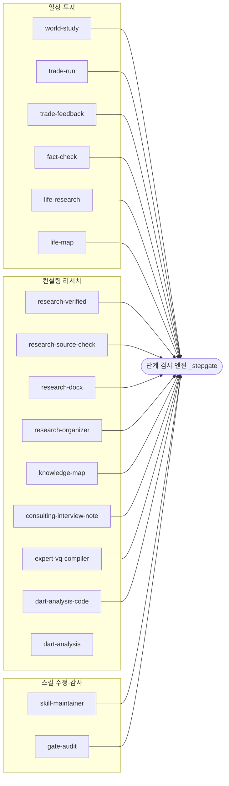
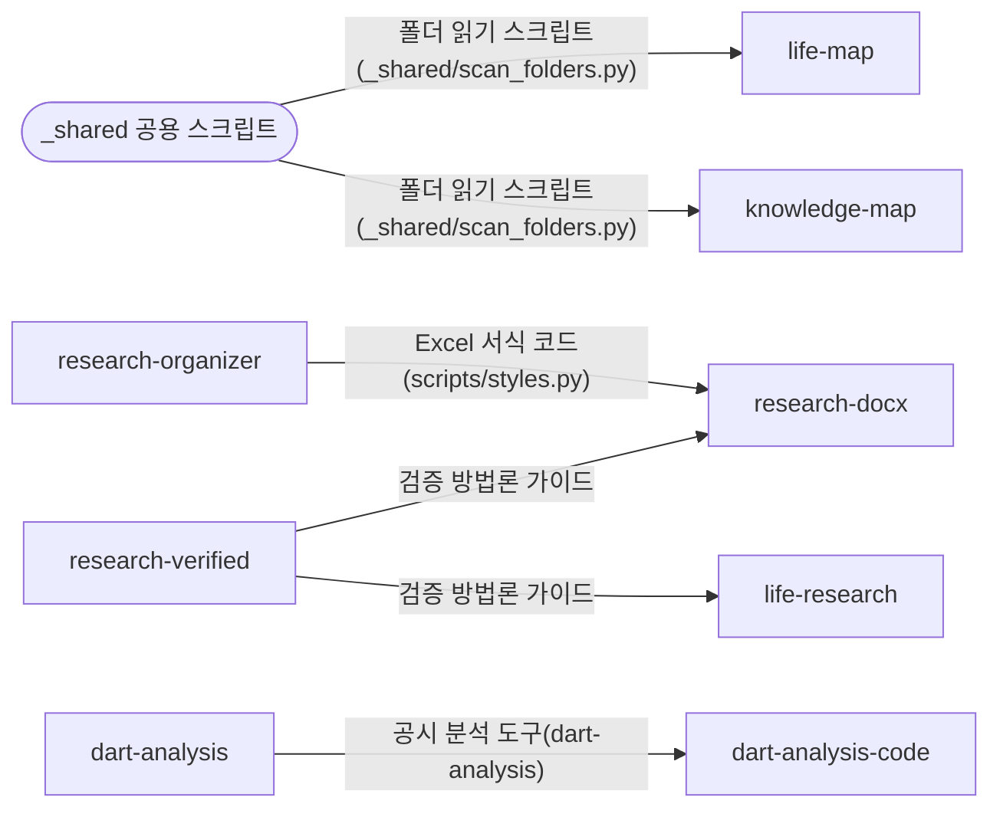
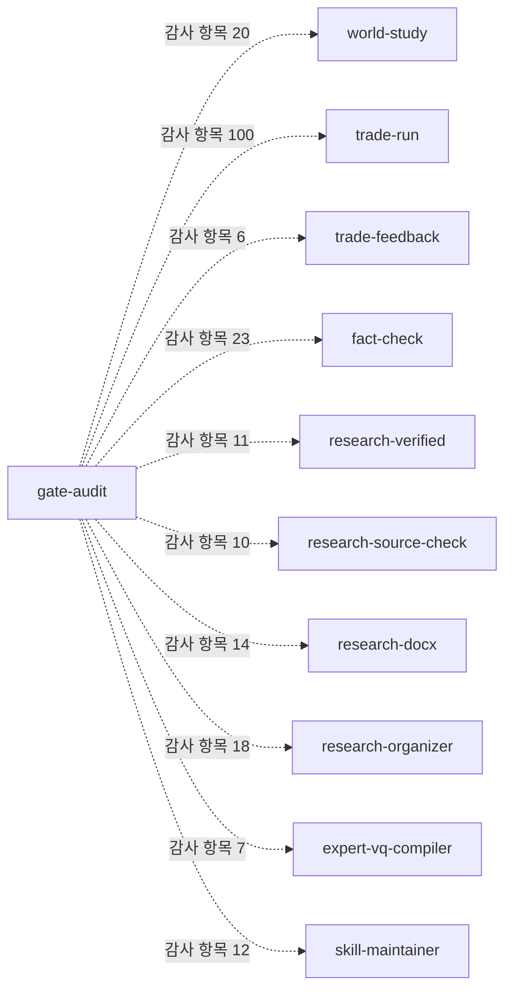

# 스킬 구성 참고 자료

이 저장소에 담긴 스킬 17개의 역할, 단계별 검사 지점, 감사 항목 수, 공유 자료와 참조 관계를 정리한 기술 참고 자료입니다. 아래 그림과 표는 `tools/skill_graph.py`가 저장소의 스킬 파일에서 읽어 생성합니다. 검사 기준표는 상세 판정 조건을 출력하지 않고 항목 이름과 개수만 집계합니다. 수치는 구현 규모를 나타내며 판단의 정확성이나 오류 감소율을 뜻하지 않습니다. 설계 판단과 운영 사례는 [스킬 운영 원칙](../06_스킬_운영_원칙.md)에 있습니다.

<!-- skill-graph:begin -->
2026-10-16 기준 집계: 스킬 17개, 단계 검사 엔진 사용 16개, 검사 지점 28개, 감사 항목 221개. 검사 기준표의 상세 판정 조건은 출력하지 않고 항목 이름과 개수만 집계했다. 구현 규모를 나타내는 수치이며 효과 지표가 아니다.

### 1. 검사 엔진 연결

### 2. 공통 자료의 재사용

### 3. 감사 대상과 항목 수

### 4. 스킬별 역할과 검사 현황

| 스킬 | 영역 | 역할 | 검사 지점 | 감사 항목 수 |
|---|---|---|---|---|
| [world-study](../../.claude/skills/world-study/SKILL.md) | 일상·투자 | 구독 뉴스레터를 읽고 사실·원인·개념을 층으로 정리한 학습 노트를 쓴다 | note | 20 |
| [trade-run](../../.claude/skills/trade-run/SKILL.md) | 일상·투자 | 뉴스·시세로 투자 시나리오를 세우고 모의매매 주문까지 여섯 단계로 실행한다 | no_trade·execute·dispatch·note·capture·carry·map | 100 |
| [trade-feedback](../../.claude/skills/trade-feedback/SKILL.md) | 일상·투자 | 매주 놓친 상승·매도 시점·손실 거래를 당시 기록과 대조해 규칙 변경을 제안하고 다음 주 재측정한다 | collect·propose·apply | 6 |
| [fact-check](../../.claude/skills/fact-check/SKILL.md) | 일상·투자 | 작성된 일상·실무 산출물의 출처 접근·일치·시효·자격을 네 값으로 판정한다 | verdict | 23 |
| [life-research](../../.claude/skills/life-research/SKILL.md) | 일상·투자 | 일상·실무 주제를 원문 직접 확인으로 조사해 출처 단 보고서를 만든다 | publish | — |
| [life-map](../../.claude/skills/life-map/SKILL.md) | 일상·투자 | 개인 프로젝트 폴더의 지식지도를 만들고 변화만 반영한다 | start·update | — |
| [research-verified](../../.claude/skills/research-verified/SKILL.md) | 컨설팅 리서치 | 컨설팅 리서치를 다중 검색·원문 확인·재검증으로 수행하고 검증 방법론 가이드로 결과를 확인한다 | absorb·fetch·publish | 11 |
| [research-source-check](../../.claude/skills/research-source-check/SKILL.md) | 컨설팅 리서치 | 완성된 컨설팅 산출물의 링크·수치·인용·단위를 출처 원문과 대조해 감리한다 | verdict | 10 |
| [research-docx](../../.claude/skills/research-docx/SKILL.md) | 컨설팅 리서치 | 검증된 내용을 컨설팅 하우스 스타일 Word 보고서로 조판한다 | publish | 14 |
| [research-organizer](../../.claude/skills/research-organizer/SKILL.md) | 컨설팅 리서치 | 정리된 리서치를 컨설팅 양식의 Excel 산출물로 만든다 | publish | 18 |
| [knowledge-map](../../.claude/skills/knowledge-map/SKILL.md) | 컨설팅 리서치 | 컨설팅 워크스트림 폴더의 지식지도를 만들고 변화만 반영한다 | start·update | — |
| [consulting-interview-note](../../.claude/skills/consulting-interview-note/SKILL.md) | 컨설팅 리서치 | 녹취 텍스트와 메타데이터로 표준 양식의 인터뷰 회의록 Word 문서를 만든다 | deliver | — |
| [expert-vq-compiler](../../.claude/skills/expert-vq-compiler/SKILL.md) | 컨설팅 리서치 | 전문가 네트워크의 사전 검증 답변 메일을 추적 스프레드시트로 정리한다 | compile | 7 |
| [dart-analysis-code](../../.claude/skills/dart-analysis-code/SKILL.md) | 컨설팅 리서치 | 공시 API로 재무제표를 수집해 비율·추세를 계산한다(dart-analysis 도구의 실행 절차) | deliver | — |
| [dart-analysis](../../.claude/skills/dart-analysis/SKILL.md) | 컨설팅 리서치 | 공시 재무제표 수집·비율·추세·Excel 산출의 원본 도구(팀 공유, 검사 없이 호출) | 없음(검사 없이 호출) | — |
| [skill-maintainer](../../.claude/skills/skill-maintainer/SKILL.md) | 스킬 수정·감사 | 스킬을 고칠 때의 절차 — 백업·편집 전후 누락 대조·코드 편집 검사·테스트 기록·정합성 검사 | verify | 12 |
| [gate-audit](../../.claude/skills/gate-audit/SKILL.md) | 스킬 수정·감사 | 끝난 작업의 검사 준수를 사후 점검하고, 산출물을 배경에서 항목별로 검수한다 | report | — |

### 5. 공유 자료와 참조 관계

| 스킬 | 범위를 나눈 짝 | 정본을 가진 공유 자료 | 사용하는 공유 자료 | 본문에서 언급하는 스킬(실행 의존 아님) |
|---|---|---|---|---|
| world-study | — | — | — | fact-check, life-research, skill-maintainer |
| trade-run | — | — | — | fact-check, life-research, skill-maintainer, trade-feedback, world-study |
| trade-feedback | — | — | — | fact-check, skill-maintainer, trade-run |
| fact-check | research-source-check | — | — | life-research, research-source-check, research-verified, skill-maintainer, trade-run, world-study |
| life-research | research-verified | — | 검증 방법론 가이드 | fact-check, life-map, research-verified |
| life-map | knowledge-map | — | 폴더 읽기 스크립트(_shared/scan_folders.py) | fact-check, knowledge-map, life-research |
| research-verified | life-research | 검증 방법론 가이드 | — | gate-audit, knowledge-map, research-docx, research-organizer, research-source-check, skill-maintainer |
| research-source-check | fact-check | — | — | fact-check, gate-audit, research-docx, research-organizer, research-verified, skill-maintainer |
| research-docx | — | — | 검증 방법론 가이드 · Excel 서식 코드(scripts/styles.py) | gate-audit, research-organizer, research-source-check, research-verified, skill-maintainer |
| research-organizer | — | Excel 서식 코드(scripts/styles.py) | — | gate-audit, research-docx, research-verified, skill-maintainer |
| knowledge-map | life-map | — | 폴더 읽기 스크립트(_shared/scan_folders.py) | dart-analysis, life-map, research-docx, research-organizer, research-verified, skill-maintainer |
| consulting-interview-note | — | — | — | gate-audit, skill-maintainer |
| expert-vq-compiler | — | — | — | gate-audit, skill-maintainer |
| dart-analysis-code | — | — | 공시 분석 도구(dart-analysis) | dart-analysis, gate-audit, research-source-check, research-verified, skill-maintainer |
| dart-analysis | — | 공시 분석 도구(dart-analysis) | — | — |
| skill-maintainer | — | — | — | dart-analysis, dart-analysis-code, fact-check, gate-audit, knowledge-map, life-map, research-organizer, trade-run, world-study |
| gate-audit | — | — | — | fact-check, skill-maintainer |
<!-- skill-graph:end -->
